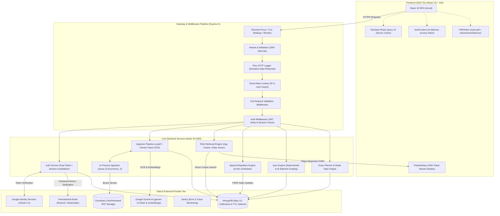

# StudyTantra: Senior Full Stack / MERN Engineer Interview Preparation Guide
## File 01: Project Overview & System Architecture

---

### Executive Summary

**Project Name**: StudyTantra (MERN AI Study Assistant)  
**Repository**: `https://github.com/UtkarshWoc/StudyTantra-MERN.git`  
**Current Branch**: `feature/level-up`  
**Target Role**: Senior Full Stack / MERN Engineer  
**Lead Architect & Primary Author**: Utkarsh Shukla (84 of 91 commits, 92.3% authorship)  
**Primary Tech Stack**: MongoDB, Express 5.2.1, React 19.2.4, Node.js 20+, Google Gemini (`gemini-2.5-flash`, `gemini-embedding-001`), TanStack Query v5, Tailwind CSS v4, `ts-fsrs` (Free Spaced Repetition Scheduler), Vitest, Playwright.

---

### 1. Grounded Interview Pitches

These pitches are engineered for Senior Engineering interviews. They emphasize architectural trade-offs, security postures, cognitive science integrations, and testing rigor rather than buzzwords.

#### 1.1 The 30-Second Elevator Pitch

> "I built **StudyTantra**, an end-to-end AI study platform that converts dense, static PDFs into an active recall and spaced-repetition study system. Instead of passively reading lecture slides or relying on ungrounded AI chat that hallucinates without proof, students get an interactive continuous-scroll PDF reader with grounded, retrieval-augmented AI chat citing exact pages, automated flashcard generation, and self-scoring quizzes. 
> 
> Under the hood, I integrated the modern **Free Spaced Repetition Scheduler (`ts-fsrs`)** to scientifically schedule daily reviews and built analytics that isolate weak topics before exams. It is engineered with Express 5, React 19, Google Gemini, and a zero-external-cost test suite with 93 unit/integration tests running in GitHub Actions."

#### 1.2 The 2-Minute Architectural Pitch

> "StudyTantra was born out of a real problem students face every semester: academic PDFs are static, dense, and disconnected from proven learning techniques like active recall and spaced repetition. Generic LLMs don't solve this because they hallucinate, cannot cite specific pages in long textbooks, and lack memory scheduling.
> 
> To solve this, I architected a full-stack MERN application paired with Google Gemini models.
> 
> **On the backend (Node 20 / Express 5)**, I built an asynchronous ingestion pipeline. When a student uploads a PDF, we validate `%PDF-` magic bytes, extract text page-by-page using `unpdf`, automatically fall back to Gemini Vision OCR if page character density is below 40 chars/page, slice content into 3200-character sentence-bounded chunks with 400-character overlap, and batch-generate 768-dimensional embeddings. For semantic retrieval, I built an in-app cosine similarity engine that seamlessly switches to MongoDB Atlas Vector Search via environment configuration.
> 
> **For the learning experience**, I implemented the modern Free Spaced Repetition Scheduler (`ts-fsrs`), requesting 90% retention with fuzzing to eliminate review clustering. Our quiz engine combines deterministic string normalization with batched LLM semantic grading for free-text answers, feeding an analytics pipeline that flags weak topics (<60% accuracy over 3+ attempts) and auto-generates exam study plans.
> 
> **On the frontend (React 19 / Vite / Tailwind v4)**, I deliberately avoided Redux boilerplate. Instead, I separated server-state caching via **TanStack React Query v5** from application state using React Context. I built a continuous vertical scroll PDF viewer with `IntersectionObserver` page tracking and programmatic scroll locks that bi-directionally sync with Server-Sent Events (SSE) AI chat citations.
> 
> **From a security and quality standpoint**, tokens are handled via in-memory short-lived JWTs and 30-day rotating SHA-256 hashed refresh tokens stored in httpOnly cookies with replay attack detection. The entire system is validated with 73 backend integration tests on ephemeral in-memory MongoDB, 20 frontend tests, and Playwright E2E workflows."

#### 1.3 The 5-Minute Technical Deep Dive Pitch

> "When discussing StudyTantra in senior engineering rounds, I focus on five pillars: product philosophy, asynchronous data pipelines, learning science algorithms, zero-trust security, and zero-cost testing infrastructure.
> 
> **1. Product Philosophy & Grounding**: Most AI document readers dump document text into a context window. That fails on a 400-page textbook due to context limits, high token costs, and attention degradation. StudyTantra is built around verifiable citations. Every AI chat response streams token-by-token over Server-Sent Events, accompanied by an initial `sources` payload containing exact document IDs and page numbers. Clicking a citation chip invokes an imperative smooth-scroll directly to that page in our custom PDF reader.
> 
> **2. Ingestion Pipeline & RAG**: Uploaded PDFs pass through an in-memory Multer parser checking magic bytes (`%PDF-`) across the first 1KB to handle UTF-8 BOMs and scanner preambles. The file is streamed to Cloudinary authenticated raw storage, and an in-process concurrency-limited queue picks up the job. We parse text per page via `unpdf`. If a page has fewer than 40 characters (scanned diagrams or slides), we send the rendered page buffer to Gemini Vision for OCR. We chunk into 3200 characters (~800 tokens) with 400-character overlap using punctuation boundaries, embed with `gemini-embedding-001`, and store 768-float vectors in MongoDB `Chunk` documents. Retrieval incorporates conversational history resolution and scores cosine similarity across chunks.
> 
> **3. Learning Science Engine**: Instead of the outdated 1980s SuperMemo SM-2 algorithm, StudyTantra implements FSRS v5 (`ts-fsrs`). FSRS models memory retention ($R = (1 + factor \cdot t / S)^{-decay}$) and tracks memory stability and difficulty per card. Daily reviews enforce separate caps on new versus due cards, and timezone boundaries are calculated dynamically using the ECMAScript `Intl.DateTimeFormat` API so midnight resets match each student's local clock. Furthermore, quiz answers update a 90-day topic accuracy matrix. When a student enters an upcoming exam date in the Study Planner, our backend runs a scheduling algorithm that distributes textbook reading, flashcard drills, and quiz reviews weighted towards their identified weak topics.
> 
> **4. Security Architecture**: We treat single-page applications as untrusted environments. Access tokens (15-minute TTL) are kept strictly in JavaScript closure memory—never in `localStorage` or `sessionStorage`—closing the door on XSS token exfiltration. Session persistence relies on an opaque 30-day refresh token stored in an `httpOnly, Secure, SameSite=Lax/None` cookie. The database stores only the SHA-256 hash. When a refresh occurs, the token rotates. If a previously consumed token is presented outside a 30-second concurrency grace window, the entire session is revoked immediately as a detected replay attack. Any password update bumps the user's `tokenVersion`, instantly rejecting active JWTs across all devices.
> 
> **5. Engineering Foundations & Testing**: Every HTTP boundary is guarded by Zod schemas. If invalid parameters or environment variables are provided, the system fails fast. To ensure reliable CI/CD without burning paid API credits, I engineered a deterministic mock AI provider with FNV-1a bag-of-words vector hashing. In our GitHub Actions pipeline, 73 backend integration tests run against `mongodb-memory-server`, 20 React Testing Library specs validate UI components, and Playwright executes end-to-end user flows completely offline."

---

### 2. Problem Solved & Target Users

#### 2.1 The Problem
1. **Passive Reading vs. Active Recall**: Students spend hundreds of hours highlighting PDF textbooks. Cognitive science proves that passive rereading produces the *illusion of competence* while resulting in rapid memory decay.
2. **Ungrounded AI Hallucinations**: Standard chatbots summarize or answer questions without verifiable source references. In medical, legal, or technical curricula, hallucinated facts can lead to failed exams or critical errors.
3. **Context Window Saturation**: Uploading an entire 300-page textbook into an LLM context window is cost-prohibitive, introduces high latency, and suffers from the 'lost in the middle' phenomenon.
4. **Maintenance Friction of Spaced Repetition**: Manually creating hundreds of Anki flashcards and tracking review intervals is time-consuming and often abandoned by busy students.

#### 2.2 Target Users
- **University & College Students**: Managing multiple semester courses with lecture slides, syllabus documents, and heavy textbooks.
- **Certification & Standardized Exam Candidates**: Studying for USMLE, Bar exams, AWS/GCP certifications, or GRE/GMAT where precision and active recall are mandatory.
- **Self-Directed Learners & Researchers**: Professionals reading academic research papers and technical whitepapers requiring verifiable citation audit trails.

---

### 3. Author's Role & Contribution Breakdown

- **Primary Architect and Lead Developer**: **Utkarsh Shukla** (`UtkarshWoc` on GitHub).
- **Authorship Metrics**: Authored **84 out of 91 git commits (92.3%)** across the repository from inception to the present `feature/level-up` branch.
- **Genesis & Team History**:
  - The project originated in late March 2026 as a collaborative exploration with peers Navneet Krishna (`navneet06dhoni`, 6 commits) and Digvijay Singh (1 commit).
  - Navneet established initial repository scaffolding and early frontend mockups (`fb8f2a9`, `abe45ae`).
  - Utkarsh took complete ownership on March 31, 2026 (commit `3cb5729`), re-architecting the backend API, integrating the Gemini AI SDK, establishing database persistence, and authoring all subsequent core features.
- **Claude Code Assistance**: Utkarsh leveraged Claude Code for targeted security hardening and refactoring (`SECURITY_FIXES.md`, commit `a2f6b5b`), improving CORS origin checks, rate-limiting layers, and cookie security.
- **Level-Up Architectural Overhaul (Phases 0–3)**: Utkarsh authored the comprehensive 4-phase productization plan (`docs/plans/level-up-and-productization-plan.md`) and executed:
  - Phase 0: Elimination of 12 critical security/logic defects (orphaned cascades, quiz answer leaks).
  - Phase 1: Robust engineering foundations (Zod validation, dual-token auth, Pino, Sentry, Vitest).
  - Phase 2: Complete RAG pipeline (`unpdf`, Gemini OCR fallback, 768-dim embeddings, SSE streaming, custom continuous-scroll PDF viewer).
  - Phase 3: Cognitive learning science (`ts-fsrs`, weak-topic analytics, 365-day SVG heatmap, automated exam study planner).

---

### 4. Tech Stack & Architectural Decisions

Every dependency in StudyTantra was selected with specific engineering trade-offs.

#### 4.1 Frontend Architecture
| Technology | Version | One-Line Architectural Justification |
|---|---|---|
| **React** | `^19.2.4` | Leverages modern JSX transform, improved concurrent rendering, and clean server-state hydration. |
| **Vite** | `^8.0.0` (v8.0.10) | Instant Hot Module Replacement (HMR) and optimized Rollup code-splitting via native ESM. |
| **Tailwind CSS** | `^4.2.2` | Zero-runtime styling using modern `@theme` design tokens and `@custom-variant dark`. |
| **React Router DOM** | `^7.13.1` | Declarative client-side routing with nested layout wrappers and auth guards (`ProtectedRoute`, `GuestRoute`). |
| **TanStack React Query** | `^5.104.2` | Replaces Redux for server-state caching, automatic background invalidation, and optimistic UI rollbacks. |
| **Axios** | `^1.14.0` | Centralized HTTP client configured with request/response interceptors for silent token refresh. |
| **react-pdf & pdfjs-dist** | `^11.0.0` | Headless, accessible canvas/text-layer PDF rendering inside the browser with worker code-splitting. |
| **react-markdown & remark-gfm**| `^10.1.0` / `^4.0.1` | Renders Markdown responses with custom regex linkifiers that convert `[p. X]` citations to interactive jump buttons. |
| **lucide-react** | `^0.577.0` | Lightweight, tree-shakeable SVG icon set for dark-mode interface elements. |
| **@sentry/react** | `^11.6.0` | Real-time frontend exception capturing with performance tracing. |

#### 4.2 Backend Architecture
| Technology | Version | One-Line Architectural Justification |
|---|---|---|
| **Node.js** | `>=20.0.0` | Native ESM support, built-in Web Crypto API, and high-performance asynchronous event loop. |
| **Express** | `^5.2.1` | Express 5 offers native async error forwarding (eliminating `express-async-errors`) and immutable query objects. |
| **Mongoose** | `^9.3.3` | Strongly-typed ODM providing schema enforcement, indexes, middleware hooks, and TTL expiration. |
| **MongoDB (Atlas / Memory)** | Modern | Document database storing complex nested study plans, chat histories, and 768-dim vector embeddings. |
| **@google/genai** | `^2.28.0` | Official Google Gen AI SDK powering Gemini 2.5 Flash for RAG chat, summaries, OCR, and grading. |
| **ts-fsrs** | `^5.4.2` | Production-grade Free Spaced Repetition Scheduler computing memory stability and interval calculations. |
| **unpdf** | `^1.8.1` | Modern server-side PDF text and metadata extraction without native build-tool C++ dependencies. |
| **zod** | `^3.25.76` | Compile-time and runtime validation for environment variables (`src/config/env.js`) and HTTP requests. |
| **jsonwebtoken** | `^9.0.3` | Cryptographically signed, stateless 15-minute Bearer access tokens. |
| **bcryptjs** | `^3.0.3` | Cross-platform salted password hashing (work factor 10) avoiding native C++ toolchain build failures. |
| **google-auth-library** | `^11.2.0` | Server-side validation of Google OAuth ID tokens (`payload.sub`) with pre-hijacking defenses. |
| **helmet** | `^8.3.0` | Sets essential HTTP security headers (Content Security Policy, HSTS, frameguard). |
| **cors** | `^2.8.6` | Strict origin whitelist validation using `Set.has()` to prevent evil subdomain prefix attacks. |
| **express-rate-limit** | `^8.7.0` | Tiered rate limiting across general API (300/15m), auth (20/15m), AI (60/hr), and grading (300/hr). |
| **pino & pino-http** | `^10.4.0` | Extremely fast structured JSON logger with automatic redaction of cookies, tokens, and passwords. |
| **cloudinary** | `^2.11.0` | Offloads binary PDF file storage to private, authenticated cloud storage. |
| **cookie-parser** | `^1.4.7` | Parses signed and unsigned browser cookies for HTTP-only refresh token extraction. |
| **nodemailer** | `^10.2.1` | Reliable transactional email delivery for email verification and password reset flows. |
| **@sentry/node** | `^11.6.0` | Uncaught exception and unhandled rejection tracing for backend production stability. |

#### 4.3 Why ZERO Redux?
Interviewers frequently ask why Redux or Redux Toolkit was omitted. The candidate should articulate:
> "Redux was designed for client-side state in an era before specialized server-cache libraries existed. In modern full-stack SPAs, over 90% of state is **Server State** (data fetched from an API that is asynchronous, shared, and requires caching, invalidation, and re-fetching). Using Redux for server data requires hundreds of lines of boilerplate reducers, actions, and thunks.
> 
> Instead, I implemented **TanStack React Query v5**, which handles caching, stale-time windows, automatic polling for asynchronous PDF processing, and optimistic updates out of the box. For true **Client State** (user authentication status and UI theme preference), lightweight React Context (`AuthContext`, `ThemeContext`) is cleaner, faster, and avoids unnecessary bundle bloat."

---

### 5. High-Level Architecture Overview

StudyTantra follows a clean multi-tier client-server architecture with an asynchronous in-process worker queue.



---

### 6. Key Features Inventory

1. **Document Management & Processing**:
   - PDF upload (up to 10MB) with `%PDF-` magic-byte inspection.
   - Dual storage driver: authenticated Cloudinary storage in cloud, local disk for dev/testing.
   - Asynchronous background ingestion with concurrency control and crash recovery.
   - Multi-page text extraction via `unpdf` with automatic Gemini Vision OCR fallback for scanned pages.
   - Sentence-bounded chunking (3200 characters, 400-character overlap) and 768-dimensional vector embedding.

2. **Grounded RAG AI Chat**:
   - Server-Sent Events (SSE) token-by-token streaming.
   - Document-level and collection-wide multi-document chat modes.
   - Exact page citation chips linked directly to PDF viewer pages.
   - History context resolution combining prior conversational turns into retrieval queries.

3. **Continuous PDF Workspace**:
   - Split-pane interface: continuous-scroll PDF on left, AI study tools on right.
   - Synchronized page indicator using `IntersectionObserver` with programmatic scroll locks.
   - Floating passage selection toolbar: "Explain", "Simplify", "Make Flashcard", "Ask in Chat".

4. **Cognitive Spaced Repetition (FSRS)**:
   - Full implementation of Free Spaced Repetition Scheduler (`ts-fsrs`).
   - Dynamic stability, difficulty, and review interval calculation.
   - Dedicated keyboard-driven review interface (`Space` to flip, `1-4` to rate).
   - Intra-session queueing of missed cards (`Again`).
   - Daily review limits (configured per user) respecting local timezones.
   - CSV and Anki-compatible TSV export.

5. **Adaptive Quizzes & Hybrid Grading**:
   - Generation across multiple formats: Multiple Choice (MCQ), True/False, Fill-in-the-Blank, Short Answer.
   - Public schema sanitization: `correctAnswer` and `explanation` stripped from client payloads until submission.
   - Hybrid grading: deterministic regex string normalization for objective items; batched semantic LLM grading for free text.
   - Per-question feedback and historical score tracking.

6. **Exam Study Planner & Weak-Topic Tracking**:
   - Automated weak-topic detection: flags topics with $<60\%$ accuracy and $\ge 3$ quiz attempts over a 90-day window.
   - Multi-document exam study planner: generates day-by-day schedules up to a 45-day horizon.
   - Synchronous optimistic task toggles on the client to prevent UI checkbox flickering.

7. **Analytics & Progress Dashboard**:
   - Hand-rolled 365-day SVG calendar activity heatmap with amber sequential color ramp.
   - Daily study goal circular gauge with real-time percentage progress.
   - Study streak calculation with timezone-aware calendar day boundaries.

---

### 7. End-to-End User Journeys & Data Flows

#### 7.1 Journey 1: Secure Authentication & Session Lifecycle
```
[User Form Submission] (email/password or Google credential)
         │
         ▼
[POST /api/auth/login or /google]
         │
         ├─► Validates via Zod schema
         ├─► Verifies password via bcryptjs (or Google ID Token via google-auth-library)
         ├─► Creates Session document in MongoDB (expires in 30 days)
         ├─► Signs 15-minute JWT containing { userId, sid, tv }
         └─► Hashes opaque 32-byte refresh token with SHA-256 and saves to Session
         │
         ▼
[HTTP Response: 200 OK]
         ├─► Body: { user, accessToken }
         └─► Set-Cookie: st_rt=<rawToken>; HttpOnly; Secure; SameSite=Lax; Path=/api/auth
         │
         ▼
[Client State Hydration]
         ├─► accessToken stored in closure variable in src/lib/api.js (never in localStorage)
         └─► User object stored in AuthContext React state
         │
         ▼
[Silent Refresh on Expiry or Page Reload]
         ├─► Axios interceptor intercepts 401 response
         ├─► Deduplicates concurrent requests using refreshPromise ??= axios.post('/auth/refresh')
         ├─► Server checks token hash; rotates to new hash; detects token replay outside 30s grace window
         └─► Re-issues fresh access token; replays original queued requests seamlessly
```

#### 7.2 Journey 2: PDF Document Upload & Background Ingestion
```
[User Drops PDF File] (<=10MB) in UploadModal.jsx
         │
         ▼
[POST /api/documents] (multipart/form-data)
         │
         ├─► Multer loads file to memory buffer
         ├─► Validates %PDF- magic bytes across initial 1024 bytes
         ├─► Uploads raw binary to Cloudinary (authenticated delivery)
         ├─► Creates Document record in MongoDB with status: 'processing', progress: 5%
         └─► Enqueues document._id into in-memory queue (services/ingestion/queue.js)
         │
         ▼
[HTTP Response: 201 Created] (Returns Document; triggers client navigation to /documents/:id)
         │
         ▼
[Client Polling via TanStack Query]
         └─► useDocument hook sets refetchInterval to 2500ms while status === 'processing'
         │
         ▼
[Background Worker Execution] (Concurrency limit: 2)
         ├─► Step 1: unpdf extracts text and page count from PDF buffer
         ├─► Step 2: If page characters < 40, invokes Gemini Vision OCR fallback
         ├─► Step 3: Writes DocumentPage records to MongoDB
         ├─► Step 4: Splits text into sentence-bounded chunks (3200 chars, 400 overlap)
         ├─► Step 5: Batch embeds chunks via gemini-embedding-001 (768 dimensions)
         ├─► Step 6: Writes Chunk records with float vectors to MongoDB
         └─► Step 7: Updates Document status: 'ready', progress: 100%
         │
         ▼
[Client Query Resolves]
         └─► Polling automatically stops; UI unlocks Chat, Flashcards, and Quizzes
```

#### 7.3 Journey 3: Grounded AI Chat with Server-Sent Events (SSE)
```
[User Submits Question] in ChatInterface.jsx
         │
         ▼
[POST /api/chat/:docId/stream]
         │
         ├─► Auth middleware verifies Bearer token and active session
         ├─► Generates embedding for query (prepended with prior question for conversational context)
         ├─► Retrieves top 6 chunks via cosine similarity (in-app or MongoDB Atlas Vector Search)
         ├─► Formats prompt with strict system instructions: "Rely ONLY on provided context. Cite page [p. X]."
         ├─► Flushes HTTP response headers: Content-Type: text/event-stream; X-Accel-Buffering: no
         │
         ▼
[Server Sends Event: sources]
         └─► data: { citations: [{ document, title, page, snippet }] }
         │
         ▼
[Client ChatStream Handler]
         └─► Parses event: sources; renders clickable citation badges above chat bubble
         │
         ▼
[Server Sends Event: token]* (Streamed as Gemini generates text)
         └─► data: { text: "..." }
         │
         ▼
[Client Appends Streamed Tokens]
         └─► Markdown renderer updates live UI; linkifier converts [p. X] into jump buttons
         │
         ▼
[User Clicks [p. 4] Citation Badge]
         └─► Invokes jumpToPage(4) -> triggers scrollToPage(4) in PdfViewer.jsx
         └─► Sets isProgrammaticScroll lock for 700ms; scrolls PDF smoothly to page 4
```

#### 7.4 Journey 4: Spaced Repetition (FSRS) Flashcard Review Session
```
[User Navigates to /review]
         │
         ▼
[GET /api/review/queue]
         │
         ├─► Calculates user's local calendar day boundary using Intl.DateTimeFormat
         ├─► Queries Flashcards where srs.due <= now (sorted by due date)
         ├─► Appends new cards (srs.state === 0) up to user's daily limit
         └─► Returns cards payload and counts { due, new, newToday, newLimit }
         │
         ▼
[Client Starts Review Session]
         ├─► Seeds local component queue state (prevents background refetches from disrupting review)
         ├─► Displays front of flashcard; user hits Space to flip 3D card
         ├─► Buttons display calculated FSRS next due intervals:
         │   [Again: 10m] [Hard: 1d] [Good: 3d] [Easy: 7d]
         │
         ▼
[User Presses Key '3' (Good)]
         │
         ▼
[POST /api/review/:cardId] { rating: 3 }
         │
         ├─► ts-fsrs calculates updated stability, difficulty, elapsed days, and next due date
         ├─► Updates Flashcard record in MongoDB
         ├─► Appends audit record in Activity collection { type: 'review', meta: { rating: 3 } }
         └─► If rating was Again (1), client appends card to end of local session queue
         │
         ▼
[Session Complete]
         └─► Invalidates ['insights'] and ['dashboard'] query keys
         └─► Dashboard streak, goal meter, and SVG heatmap update immediately
```

---

### 8. Verification & Flagged Items for Author Confirmation

In strict compliance with our forensic integrity protocol, all findings above have been cross-verified against the physical codebase. The following items cannot be fully verified from code alone and must be confirmed with the candidate:

1. **[UNCLEAR, confirm with author] Active Production Transactional Email Provider**:
   - The repository implements both Nodemailer (Gmail App Passwords/custom SMTP) and Resend API in `backend/src/services/email.js`. Confirm whether the live production deployment uses Gmail SMTP or a verified domain on Resend.
2. **[VERIFY] Live Production Deployment URL & Uptime**:
   - `frontend/vercel.json` and CORS whitelist reference `https://study-tantra-mern.vercel.app`. Verify that the live deployment and its backend container on Railway are active before presenting in live interviews.
3. **[VERIFY] MongoDB Atlas Vector Search Index Configuration**:
   - Code supports `VECTOR_SEARCH=atlas` (`backend/src/services/retrieval.js:31-44`), but `.env.example` defaults to `VECTOR_SEARCH=app`. Confirm whether the Atlas search index named `"chunk_embeddings"` was provisioned on the production cluster or if production operates on in-app cosine similarity.
4. **[UNCLEAR, confirm with author] Real-World User Numbers & Scale Metrics**:
   - There are no telemetry trackers (PostHog, Mixpanel) in the repository. Avoid citing unsubstantiated daily active user counts. Confirm any actual pilot user numbers with the author.
5. **[UNCLEAR, confirm with author] Header `Cmd+K` Keyboard Shortcut**:
   - `frontend/src/components/Header.jsx` displays a `<kbd>Cmd+K</kbd>` badge visually, but lacks a global `keydown` event listener to focus search. Confirm if this is an intentional cosmetic roadmap item.

---
*End of File 01: Project Overview & System Architecture*
