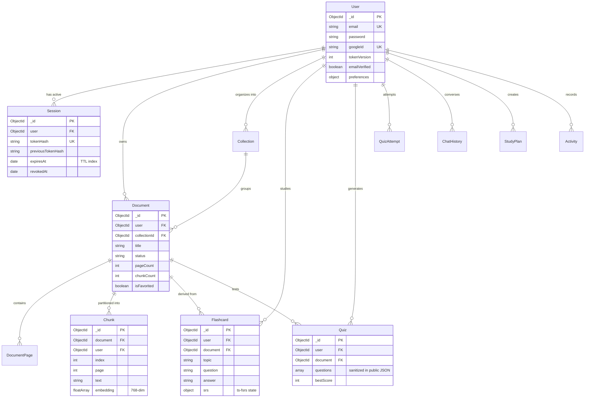

# StudyTantra: Senior Full Stack / MERN Engineer Interview Preparation Guide
## File 02: Technical Deep Dive & Codebase Walkthrough

---

### Executive Summary

This document provides an exhaustive, code-grounded technical deep dive into **StudyTantra**. It covers the repository's modules, data models, design patterns, algorithms, security posture, testing strategy, and prepared line-by-line code explanations. Every claim references verified files and line numbers in `c:\Users\utkar\StudyTantra-MERN`.

---

### 1. Major Module & File Walkthrough

The project is structured as an npm monorepo with workspaces: `backend/` and `frontend/`.

```
StudyTantra-MERN/
├── backend/
│   ├── src/
│   │   ├── config/          # Environment validation (env.js), DB (db.js), Logger, Cloudinary
│   │   ├── controllers/     # 11 Express controllers managing 54 API endpoints
│   │   ├── middlewares/     # Auth, error handling, rate limiting, validation, file upload
│   │   ├── models/          # 12 Mongoose ODM models with indexes and TTLs
│   │   ├── routes/          # Express 5 route definitions with Zod schema bindings
│   │   ├── services/        # AI orchestration, FSRS spaced repetition, RAG retrieval, ingestion
│   │   │   ├── ai/          # Provider abstraction (Gemini 2.5 Flash vs offline Mock)
│   │   │   └── ingestion/   # Concurrency-controlled queue, PDF extraction, vector embeddings
│   │   ├── utils/           # Tenancy isolation (ownership.js), hybrid grading, HTTP errors
│   │   ├── validators/      # Zod request boundary schemas
│   │   ├── app.js           # Express app setup, global middleware stack, readiness probes
│   │   ├── instrument.js    # Sentry error instrumentation (loaded first)
│   │   └── server.js        # HTTP server entry point, background DB connect, graceful shutdown
│   └── tests/               # 73 Vitest integration test cases running against mongodb-memory-server
├── frontend/
│   ├── src/
│   │   ├── api/             # TanStack Query custom hooks (hooks.js) and centralized query keys
│   │   ├── components/      # 17 reusable UI components (PdfViewer, ChatInterface, QuizEngine, etc.)
│   │   ├── context/         # AuthContext (in-memory JWT), ThemeContext (dark/light)
│   │   ├── lib/             # Axios API client with silent refresh, SSE chat stream reader
│   │   ├── pages/           # 15 React Router views (Dashboard, Documents, Review, Planner, etc.)
│   │   ├── App.jsx          # Route definitions, ProtectedRoute & GuestRoute guards
│   │   └── main.jsx         # React 19 root bootstrap, TanStack QueryClient, Sentry React init
│   ├── e2e/                 # Playwright test specs (happy-path, learning flows)
│   └── vite.config.js       # Vite 8 config with Rollup chunk size overrides and test environment
```

#### 1.1 Backend Modules

##### 1. `backend/src/server.js` & `backend/src/app.js`
- **What it does**: Bootstraps the Express application. Configures security middlewares (Helmet, CORS whitelist), request logging (Pino), rate limiting, body parsing, and routes.
- **Why designed this way**:
  - `server.js` starts the HTTP listener (`app.listen`) **before** MongoDB connects. Cloud hosting providers (e.g. Railway) have aggressive port-binding health probes. If a database connection takes 3 seconds, delaying HTTP binding causes the deployment to be killed.
  - A database readiness guard in `app.js:86-91` checks `mongoose.connection.readyState !== 1` for `/api` calls. If the DB is still connecting, it immediately responds with `503 Service Unavailable`, preventing Mongoose query buffering timeouts.
- **Alternatives considered**: Connecting to MongoDB before starting `app.listen`. Rejected because it causes health-check timeouts on PaaS cold starts.

##### 2. `backend/src/services/ingestion/` (`queue.js`, `ingest.js`, `pdf.js`, `chunk.js`)
- **What it does**: Ingests uploaded PDF documents asynchronously. Extracts text per page via `unpdf`. If a page contains $<40$ characters, it falls back to Gemini Vision OCR. Chunks text into 3200-character segments with 400-character overlap. Generates 768-dimensional embeddings using `gemini-embedding-001` and persists `Chunk` records.
- **Why designed this way**:
  - Controlled concurrency (`CONCURRENCY = 2`) in `queue.js` prevents CPU spikes and memory exhaustion when multiple students upload large PDFs simultaneously.
  - `resumePendingIngestion()` runs on server startup, re-enqueuing any documents stuck in `'processing'` due to a previous crash or deployment restart.
- **Alternatives considered**: Redis + BullMQ. Rejected for the current architecture to keep infrastructure requirements minimal and self-contained; in-memory queue handles current loads cleanly.

##### 3. `backend/src/services/retrieval.js`
- **What it does**: Executes vector similarity searches for RAG chat and quiz generation. Supports two search engines:
  1. `searchInApp`: In-process cosine similarity calculation across chunks retrieved from MongoDB.
  2. `searchAtlas`: Vector search using MongoDB Atlas `$vectorSearch` pipeline on the `chunk_embeddings` index.
- **Why designed this way**: Allows seamless switching between zero-dependency local execution (`VECTOR_SEARCH=app`) and production Atlas Vector Search (`VECTOR_SEARCH=atlas`) via environment variable.
- **Alternatives considered**: External dedicated vector databases (Pinecone, Weaviate). Rejected because storing vectors directly in MongoDB eliminates data synchronization drift and reduces third-party vendor costs.

##### 4. `backend/src/services/srs.js`
- **What it does**: Implements the **Free Spaced Repetition Scheduler (`ts-fsrs`)**. Computes memory stability, difficulty, review intervals, and next due dates based on 4 rating options (1=Again, 2=Hard, 3=Good, 4=Easy). Manages daily caps for new cards versus due reviews.
- **Why designed this way**: FSRS outperforms the traditional 1980s SM-2 algorithm (used in older Anki versions) by modeling memory decay exponentially ($R = (1 + factor \cdot t / S)^{-decay}$) and dynamically adapting to individual student forgetting curves.
- **Alternatives considered**: SM-2. Rejected due to rigid interval calculations and inability to target specific retention rates (StudyTantra targets 90% retention with fuzzing).

##### 5. `backend/src/utils/ownership.js`
- **What it does**: Centralizes tenancy authorization with `findOwned(Model, id, userId, label)`.
- **Why designed this way**: Performs `mongoose.isValidObjectId(id)` and queries `{ _id: id, user: userId }`. If an object belongs to another user or does not exist, it **always returns a 404 Not Found** (never 401 or 403). This completely prevents ID enumeration and Insecure Direct Object Reference (IDOR) attacks.
- **Alternatives considered**: Checking existence first, then checking `doc.user.equals(userId)` and returning 403 Forbidden. Rejected because returning 403 leaks whether a resource ID exists in the database.

##### 6. `backend/src/utils/grading.js`
- **What it does**: Grades quiz submissions using a hybrid deterministic/AI evaluation strategy.
- **Why designed this way**:
  - Objective questions (MCQ, True/False) and exact-match fill-in-the-blanks are graded synchronously in Node.js using normalized string comparisons.
  - Only free-text answers (`fill_blank`, `short_answer`) that did not match exactly are bundled into a single batched LLM call (`gradeAnswers`) requesting structured JSON feedback.
  - Drastically reduces LLM API costs and avoids multiple serial network round-trips.
- **Alternatives considered**: Sending all questions to the LLM. Rejected due to latency (2-5 seconds), token waste, and non-deterministic grading on simple MCQs.

#### 1.2 Frontend Modules

##### 1. `frontend/src/lib/api.js`
- **What it does**: Configures the Axios instance. Manages the in-memory access token, attaches `Authorization: Bearer <token>` headers, and implements concurrent-safe silent token refresh via response interceptors.
- **Why designed this way**:
  - Storing access tokens in `localStorage` exposes them to Cross-Site Scripting (XSS) exfiltration. Storing tokens strictly in closure memory makes them unreadable to malicious third-party scripts.
  - Uses `refreshPromise ??= axios.post(...)` to coalesce simultaneous 401 errors into a single refresh request.
- **Alternatives considered**: Storing JWT in `localStorage`. Rejected for security reasons.

##### 2. `frontend/src/lib/chatStream.js`
- **What it does**: Implements a custom Server-Sent Events (SSE) reader over native `fetch()`. Parses chunked HTTP responses, splits events at `\n\n` boundaries, and dispatches callbacks (`onSources`, `onToken`).
- **Why designed this way**: Axios does not support browser ReadableStreams. The custom reader decodes binary stream chunks with `TextDecoder({ stream: true })` to properly handle multi-byte UTF-8 character splits.
- **Alternatives considered**: `EventSource` API. Rejected because standard `EventSource` only supports `GET` requests; sending conversational context and query text requires `POST`.

##### 3. `frontend/src/components/PdfViewer.jsx`
- **What it does**: Renders multi-page PDFs using `react-pdf` in continuous vertical scroll mode. Tracks visible pages via `IntersectionObserver` and provides smooth programmatic scrolling to cited pages.
- **Why designed this way**: Employs an `isProgrammaticScroll` flag with a 700ms debounce to prevent feedback loops between user scroll detection and programmatic citation jumping.
- **Alternatives considered**: Page-by-page flipping (stepper). Rejected because academic reading requires continuous vertical scanning across page margins.

##### 4. `frontend/src/api/hooks.js`
- **What it does**: Houses all TanStack React Query custom hooks. Manages cache keys, conditional polling for processing documents, and optimistic updates.
- **Why designed this way**: Encapsulates data fetching and mutation logic away from presentation components. Implements synchronous optimistic state updates for study planner task checkboxes to prevent UI flickering.

---

### 2. Key Algorithms, Data Structures & Design Patterns

#### 2.1 Key Algorithms

##### 1. Free Spaced Repetition Scheduler (FSRS v5)
- **Location**: `backend/src/services/srs.js:5-30` using `ts-fsrs`
- **Algorithm Mechanics**:
  - Replaces SM-2's linear multiplier with a bivariate model of memory: **Stability ($S$)** (time in days for retrievability to drop from 100% to 90%) and **Difficulty ($D$)** (inherent card complexity from 1 to 10).
  - Configured with `request_retention: 0.9` and `enable_fuzz: true`. Fuzzing adds small deterministic pseudo-random offsets to calculated intervals to prevent "review avalanches" (hundreds of cards falling due on the exact same date).
  - Cards transition through 4 states: `0=New`, `1=Learning`, `2=Review`, `3=Relearning`.

##### 2. Sentence-Boundary Chunking with Sliding Window Overlap
- **Location**: `backend/src/services/ingestion/chunk.js:14-48`
- **Algorithm Mechanics**:
  - Configured with `maxChars: 3200` (~800 tokens) and `overlapChars: 400` (~100 tokens).
  - Iterates through extracted page text. Instead of slicing blindly at index 3200, it looks backward for sentence terminators (`. `, `! `, `? `, `\n\n`).
  - If no terminator is found within 30% of the slice limit, it falls back to word boundaries (whitespace).
  - Prepends the trailing 400 characters of the preceding chunk to preserve syntactic context across chunk seams.

##### 3. Hybrid RAG Query Context Resolution
- **Location**: `backend/src/services/ai/gemini.js:133-145`
- **Algorithm Mechanics**:
  - Conversational questions often use pronouns or ellipsis (e.g., "What are its symptoms?").
  - The retrieval engine concatenates the immediate prior user question with the current question before computing the embedding vector (`gemini-embedding-001` with `taskType: 'RETRIEVAL_QUERY'`).
  - Cosine similarity ranking retrieves the top 6 chunks. System prompt injects these chunks with strict instructions: *"Rely ONLY on the provided context. If the answer is not in the text, say so. Always cite sources as [p. X]"*.

##### 4. 90-Day Weak-Topic Detection
- **Location**: `backend/src/services/studyPlan.js:31-64`
- **Algorithm Mechanics**:
  - Aggregates all `QuizAttempt` documents for a user over a rolling 90-day window.
  - Groups answers by `topic` and computes:
    $$\text{Accuracy} = \frac{\text{Correct Answers}}{\text{Total Answers}}$$
  - A topic is classified as **Weak** if:
    $$\text{Total Answers} \ge 3 \quad \land \quad \text{Accuracy} < 0.60$$
  - When generating an exam study plan, the algorithm assigns higher daily study minute allocations and review task frequencies to these weak topics.

#### 2.2 Data Structures
- **Embeddings Array**: 768-element Float32 array stored inside each MongoDB `Chunk` document.
- **In-Memory FIFO Queue**: Array-based deque (`pending = []`) coupled with a `Set()` of active document IDs for $O(1)$ duplicate checking (`backend/src/services/ingestion/queue.js`).
- **Activity Heatmap Matrix**: 365-day sparse map indexed by ISO date string (`YYYY-MM-DD`) tracking review and quiz counts, rendered directly as SVG rect elements.

#### 2.3 Software Design Patterns
- **Provider Pattern**: AI functionality is decoupled behind an interface (`services/ai/index.js`), switching between `GeminiProvider` (`@google/genai`) and `MockProvider` based on `env.AI_PROVIDER`.
- **Tenancy Boundary Pattern**: `findOwned()` enforces row-level multi-tenancy security at the data access layer.
- **Optimistic UI Pattern**: TanStack Query updates local cache state immediately on user action with snapshot rollback in `onError`.
- **Interceptors / Middleware Pattern**: Centralized cross-cutting concerns (token injection, error normalization, rate limiting, logging).

---

### 3. Database Design & Schema Architecture

StudyTantra utilizes **MongoDB** with **Mongoose 9.3.3**, encompassing 12 distinct models.



#### Detailed Model Specifications

| Model | Collection | Key Fields | Primary & Compound Indexes | Special Characteristics |
|---|---|---|---|---|
| **User** | `users` | `name`, `email`, `password`, `googleId`, `tokenVersion`, `preferences` (`dailyGoal`, `timezone`) | `{ email: 1 }` (unique), `{ googleId: 1 }` (sparse, unique) | `toPublicJSON()` strips password and token hashes. Pre-save hook for bcrypt salt hashing. |
| **Session** | `sessions` | `user`, `tokenHash` (SHA-256), `previousTokenHash`, `rotatedAt`, `expiresAt`, `revokedAt` | `{ tokenHash: 1 }` (unique), `{ user: 1 }`, `{ expiresAt: 1 }` (TTL: `expireAfterSeconds: 0`) | **TTL Index** automatically purges expired sessions from database. Supports token rotation. |
| **Document** | `documents` | `user`, `title`, `collectionId`, `status` (`processing`\|`ready`\|`failed`), `progress`, `pageCount`, `chunkCount` | `{ user: 1, createdAt: -1 }`, `{ user: 1, collectionId: 1 }` | `toJSON` transform cleans internal storage metadata (`filePath`, `cloudinaryPublicId`). |
| **DocumentPage** | `documentpages` | `document`, `page`, `text` | `{ document: 1, page: 1 }` (unique) | Dedicated collection for full-page text lookups without chunk fragmentation. |
| **Chunk** | `chunks` | `user`, `document`, `index`, `page`, `pageEnd`, `text`, `embedding` (768 floats) | `{ document: 1, index: 1 }`, `{ user: 1 }` | Stores raw text slices and vector embeddings for semantic similarity searches. |
| **Flashcard** | `flashcards` | `user`, `document`, `topic`, `question`, `answer`, `isFavorite`, `srs` (embedded sub-doc) | `{ user: 1, document: 1 }`, `{ user: 1, 'srs.due': 1 }` | `srs` object embeds `stability`, `difficulty`, `due`, `state`, `reps`, `lapses`. |
| **Quiz** | `quizzes` | `user`, `document`, `collectionId`, `questions` (array of sub-docs), `attemptsCount`, `bestScore` | `{ user: 1, document: 1, createdAt: -1 }`, `{ user: 1, collectionId: 1, createdAt: -1 }` | **Security**: `toPublicJSON()` strips `correctAnswer` and `explanation` to prevent client cheat inspection. |
| **QuizAttempt**| `quizattempts` | `user`, `quiz`, `answers` (with feedback & topic), `score`, `total`, `percentage` | `{ user: 1, createdAt: -1 }`, `{ quiz: 1, createdAt: -1 }` | Immutable ledger of student exam performances. |
| **ChatHistory**| `chathistories`| `user`, `document`, `collectionId`, `history` (`role`, `content`, `citations`) | `{ user: 1, document: 1 }`, `{ user: 1, collectionId: 1 }` | Stores ongoing multi-turn conversations and page citations. |
| **Collection** | `collections` | `user`, `name`, `color` | `{ user: 1, name: 1 }` (unique) | Groups multiple documents for cross-document RAG chat and aggregate quizzes. |
| **StudyPlan** | `studyplans` | `user`, `title`, `examDate`, `minutesPerDay`, `documents`, `days` (nested tasks array) | `{ user: 1, examDate: 1 }` | Day-by-day study schedule with task completion checkboxes. |
| **Activity** | `activities` | `user`, `type` (`upload`\|`review`\|`quiz`\|`chat`\|`generate`), `document`, `meta` | `{ user: 1, createdAt: -1 }`, `{ user: 1, type: 1, createdAt: -1 }` | Append-only activity log powering the 365-day SVG heatmap and streak calculations. |

---

### 4. API Design & Complete Route Architecture

The API comprises **54 endpoints** organized under Express 5 routers. All endpoints adhere to REST conventions, appropriate HTTP status codes (`200`, `201`, `202`, `400`, `401`, `403`, `404`, `409`, `429`, `503`), and JSON envelopes.

#### Endpoint Inventory by Module

##### 1. Health & Root (`backend/src/app.js`)
- `GET /` — API liveness check (`200 OK`).
- `GET /healthz` — Readiness probe checking `mongoose.connection.readyState` (`200 OK` or `503 Service Unavailable`).

##### 2. Authentication (`backend/src/routes/authRoutes.js`) — Prefix: `/api/auth`
- `POST /register` — User signup. Sets httpOnly refresh cookie (`st_rt`), returns JWT (`201 Created`).
- `POST /login` — Password authentication. Sets cookie, returns JWT (`200 OK`).
- `POST /google` — Google OAuth ID token verification and sign-in (`200 OK`).
- `POST /refresh` — Rotates refresh token, returns new 15-minute access JWT (`200 OK`).
- `POST /logout` — Revokes current session in MongoDB, clears cookie (`200 OK`).
- `POST /logout-others` — Revokes all active sessions for user except current (`200 OK`).
- `GET /me` — Returns current authenticated user profile (`200 OK`).
- `POST /forgot-password` — Dispatches password reset email (`200 OK`, timing invariant).
- `POST /reset-password` — Consumes reset token, updates password, increments `tokenVersion` (`200 OK`).
- `POST /verify-email` — Confirms email address from verification token (`200 OK`).
- `POST /resend-verification` — Resends verification email with rate limit (`200 OK`).
- `PUT /profile` — Updates name or requests email change (`200 OK`).
- `PUT /preferences` — Updates `dailyGoal`, `newCardsPerDay`, and `timezone` (`200 OK`).
- `PUT /password` — Changes password, updates `tokenVersion`, returns new JWT (`200 OK`).
- `DELETE /account` — Irreversibly deletes account and cascades deletions across all 11 collections (`200 OK`).

##### 3. Documents (`backend/src/routes/documentRoutes.js`) — Prefix: `/api/documents`
- `POST /` — Uploads PDF (Multer memory, 10MB limit, magic-byte inspection), enqueues ingestion (`201 Created`).
- `GET /` — Lists user's documents sorted chronologically (`200 OK`).
- `GET /:id` — Retrieves document details and processing progress (`200 OK`).
- `PATCH /:id` — Renames document or assigns to collection (`200 OK`).
- `DELETE /:id` — Triggers cascading deletion of document and all associated data (`200 OK`).
- `GET /:id/file` — Streams binary PDF with `Content-Disposition: inline` and private caching headers (`200 OK`).
- `POST /:id/reprocess` — Re-triggers background ingestion pipeline on failure (`202 Accepted`).
- `PUT /:id/favorite` — Toggles `isFavorited` boolean (`200 OK`).

##### 4. AI & Passage Tools (`backend/src/routes/aiRoutes.js`) — Prefix: `/api/ai`
- `POST /summary/:docId` — Generates or returns cached Markdown document summary (`200 OK`).
- `POST /explain/:docId` — Explains or simplifies a selected passage (3-2000 chars) (`200 OK`).

##### 5. Flashcards (`backend/src/routes/flashcardRoutes.js`) — Prefix: `/api/flashcards`
- `POST /generate/:docId` — Generates flashcards with configurable count, scope, difficulty (`201 Created`).
- `POST /from-selection/:docId` — Generates a single targeted flashcard from highlighted passage (`201 Created`).
- `GET /:docId` — Retrieves all flashcards for a document (`200 OK`).
- `GET /export/:docId` — Downloads flashcards formatted as CSV or Anki-compatible TSV (`200 OK`).
- `PUT /:id/favorite` — Toggles flashcard favorite flag (`200 OK`).
- `DELETE /:id` — Deletes single flashcard (`200 OK`).

##### 6. Grounded Chat (`backend/src/routes/chatRoutes.js`) — Prefix: `/api/chat`
- `POST /:docId/stream` — Streams single-document RAG chat over Server-Sent Events (`200 OK`).
- `POST /:docId` — Non-streaming fallback returning full reply and citations (`200 OK`).
- `GET /:docId` — Retrieves chat conversation history (`200 OK`).
- `DELETE /:docId` — Clears document chat history (`200 OK`).
- `POST /collection/:collectionId/stream` — Multi-document cross-collection streaming chat (`200 OK`).
- `POST /collection/:collectionId` — Multi-document non-streaming chat (`200 OK`).
- `GET /collection/:collectionId` — Retrieves collection chat history (`200 OK`).
- `DELETE /collection/:collectionId` — Clears collection chat history (`200 OK`).

##### 7. Quizzes (`backend/src/routes/quizRoutes.js`) — Prefix: `/api/quizzes`
- `POST /generate/:docId` — Generates quiz; returns sanitized questions without answer key (`201 Created`).
- `POST /generate/collection/:collectionId` — Generates cross-document collection quiz (`201 Created`).
- `GET /document/:docId` — Lists quizzes for a document (`200 OK`).
- `GET /collection/:collectionId` — Lists quizzes for a collection (`200 OK`).
- `GET /:id` — Retrieves quiz details (`200 OK`).
- `POST /:id/check` — Checks single question answer with instant feedback (`200 OK`).
- `POST /:id/submit` — Grades full quiz submission, records `QuizAttempt`, returns answer key (`200 OK`).
- `GET /:id/attempts` — Returns student's historical attempts and scores (`200 OK`).

##### 8. Learning, Spaced Repetition & Analytics (`backend/src/routes/learningRoutes.js`)
- `GET /api/review/queue` — Fetches due and new cards for current date (`200 OK`).
- `POST /api/review/:id` — Submits review rating (1-4); updates FSRS parameters (`200 OK`).
- `GET /api/insights/overview` — Dashboard stats (streak, daily goal, due counts, SVG heatmap) (`200 OK`).
- `GET /api/insights/topics` — Topic accuracy metrics with weak topic flags (`200 OK`).
- `GET /api/dashboard` — High-level metric aggregates (`200 OK`).
- `GET /api/collections` — Lists collections with document counts (`200 OK`).
- `POST /api/collections` — Creates a new collection (`201 Created`).
- `GET /api/collections/:id` — Retrieves collection with populated documents (`200 OK`).
- `PUT /api/collections/:id` — Updates collection name and color (`200 OK`).
- `DELETE /api/collections/:id` — Deletes collection (ungroups documents without deleting them) (`200 OK`).
- `GET /api/plans` — Lists user study plans (`200 OK`).
- `POST /api/plans` — Generates AI exam study plan (`201 Created`).
- `GET /api/plans/:id` — Retrieves study plan schedule (`200 OK`).
- `PATCH /api/plans/:id/tasks/:taskId` — Toggles task completion (`200 OK`).
- `DELETE /api/plans/:id` — Deletes study plan (`200 OK`).

---

### 5. Authentication, Security & Defense-in-Depth

The security architecture follows a zero-trust model for single-page applications.

```mermaid
sequenceDiagram
    autonumber
    actor User
    participant Browser as React 19 Client
    participant API as Express 5 Gateway
    participant DB as MongoDB Atlas

    User->>Browser: Submit Login Form
    Browser->>API: POST /api/auth/login { email, password }
    API->>DB: Find User by email
    API->>API: bcrypt.compare(password, hash)
    API->>DB: Create Session { user, tokenHash: SHA256(rawRefreshToken), expiresAt: 30d }
    API-->>Browser: 200 OK<br/>Body: { user, accessToken: JWT }<br/>Set-Cookie: st_rt=rawRefreshToken; HttpOnly; Secure; SameSite=Lax
    Note over Browser: accessToken stored in JS memory closure<br/>Cookie stored securely by browser engine

    Browser->>API: GET /api/documents (Headers: Authorization: Bearer <JWT>)
    API->>API: verifyAccessToken(JWT) -> { userId, sid, tv }
    API->>DB: Verify Session.revokedAt is null & tv === User.tokenVersion
    API-->>Browser: 200 OK [Documents payload]

    Note over Browser: 15 minutes elapse... JWT expires
    Browser->>API: GET /api/documents (Expired JWT)
    API-->>Browser: 401 Unauthorized
    Note over Browser: Axios interceptor catches 401<br/>Coalesces concurrent requests via refreshPromise ??= ...
    Browser->>API: POST /api/auth/refresh (Browser sends st_rt cookie)
    API->>DB: Lookup Session by SHA256(st_rt)
    alt Token Reused Outside 30s Grace Window
        API->>DB: Revoke entire Session (Replay Attack Detected)
        API-->>Browser: 401 Unauthorized (Force re-login)
    else Valid Refresh Token
        API->>DB: Rotate tokenHash, save previousTokenHash & rotatedAt
        API-->>Browser: 200 OK<br/>Body: { accessToken: newJWT }<br/>Set-Cookie: st_rt=newRawRefreshToken
        Browser->>API: Replay original failed request with new JWT
        API-->>Browser: 200 OK [Documents payload]
    end
```

#### Security Guardrails Matrix

| Threat Vector | Mitigation Strategy Implemented in Code | Exact Source File Reference |
|---|---|---|
| **XSS Token Exfiltration** | Access JWTs are stored strictly in module memory (`let accessToken = null;`); never written to `localStorage` or `sessionStorage`. | `frontend/src/lib/api.js:15` |
| **CSRF Attacks** | Refresh cookies enforce `SameSite: 'lax'` (or `'none'` with `secure: true` in production) and are scoped strictly to `Path: '/api/auth'`. State-mutating API calls require `Authorization: Bearer` headers which browsers never send automatically. | `backend/src/services/auth.js:28-36` |
| **Refresh Token Replay** | Token rotation tracks `previousTokenHash` with a 30-second concurrency grace window (`REUSE_GRACE_MS = 30000`). Presentation of an old token outside this window immediately revokes the session. | `backend/src/services/auth.js:125-144` |
| **Instant Multi-Device Logout** | Changing passwords increments `user.tokenVersion`. The auth middleware validates `decoded.tv === user.tokenVersion`, instantly rejecting active JWTs across all devices before the 15-minute expiration. | `backend/src/middlewares/authMiddleware.js:28` |
| **OAuth Pre-Hijacking** | If a user signs in via Google OAuth and an unverified account exists with that email, the unverified account is evicted to an unroutable address (`unclaimed+<id>@invalid.studytantra`) and a fresh verified account is created. | `backend/src/controllers/authController.js:105-112` |
| **IDOR & ID Enumeration** | `findOwned()` enforces `{ _id, user }` multi-tenancy and always returns `404 Not Found` rather than `403 Forbidden` if a resource is owned by another user. | `backend/src/utils/ownership.js:6-11` |
| **Malicious File Uploads** | PDF uploads inspect `%PDF-` magic bytes across the initial 1024 bytes (handling UTF-8 BOMs and scanner headers) and enforce a strict 10MB limit in memory before cloud upload. | `backend/src/middlewares/upload.js:9-30` |
| **CORS Origin Bypass** | Whitelist uses `new Set(allowedOrigins).has(origin)`, preventing regex prefix bypass vulnerabilities (e.g. `study-tantra-mern.vercel.app.evil.com`). | `backend/src/app.js:32-47` |
| **LLM Output Manipulation** | Gemini requests enforce structured JSON schemas (`responseMimeType: 'application/json'`), eliminating prompt injection jailbreaks in generated flashcards and quizzes. | `backend/src/services/ai/gemini.js:192-230` |
| **Brute Force & DoS** | Tiered rate limiting: 300 req/15m (General API), 20 req/15m (Credentials), 60 req/hr (AI endpoints), 300 req/hr (Grading). Express JSON parser limited to 1MB. | `backend/src/app.js:52`, `routes/authRoutes.js:24` |
| **Sensitive Data Logging** | Pino HTTP logger redacts `Authorization`, `Cookie`, `Set-Cookie`, passwords, and token fields from log streams. | `backend/src/config/logger.js:12-25` |

---

### 6. State Management, Error Handling & Logging

#### 6.1 State Management (TanStack React Query v5 + Context API)
The frontend architecture explicitly separates **Server State** from **Client State**:
- **Server State (TanStack Query)**:
  - Cache default `staleTime: 30_000` (30 seconds) in `main.jsx`.
  - Conditional polling: `refetchInterval: (query) => (query.state.data?.some(d => d.status === 'processing') ? 2500 : false)` automatically tracks background ingestion.
  - Cross-query cache hydration: fetching document details updates the document list cache (`keys.documents`) without extra network round-trips.
  - Synchronous optimistic updates: `useTogglePlanTask` updates the cache synchronously inside the click handler before dispatching `mutation.mutate()`, preventing React 19 controlled checkboxes from flickering.
- **Client State (React Context)**:
  - `AuthContext`: Manages current user profile and session initialization.
  - `ThemeContext`: Manages dark, light, and system theme classes.

#### 6.2 Error Handling & Resilience
- **Express 5 Native Async Errors**: Express 5 automatically routes rejected promises from `async` route handlers to the global error middleware, eliminating the need for `express-async-errors` wrappers.
- **Custom `HttpError` Hierarchy**: `backend/src/utils/errors.js` defines `badRequest(400)`, `unauthorized(401)`, `forbidden(403)`, `notFound(404)`, `conflict(409)`, `tooManyRequests(429)`.
- **Sanitized Error Responses**: The global error handler (`backend/src/middlewares/errorHandler.js`) logs full stack traces internally via Pino but strips error stacks and database error details in production responses.
- **Process Exception Traps**: `server.js` listens for `uncaughtException` (logs fatal and exits with code 1 so the container restarts cleanly) and `unhandledRejection` (logs error without terminating).
- **Sentry Integration**: `@sentry/node` instruments backend Express routes; `@sentry/react` catches uncaught client component errors.

#### 6.3 Structured Logging (Pino)
- Fast, non-blocking JSON logging using `pino` and `pino-http`.
- Automatic redaction of sensitive paths: `['req.headers.authorization', 'req.headers.cookie', 'res.headers["set-cookie"]', 'req.body.password']`.
- Dev mode automatically switches to colorized, human-readable console output via `pino-pretty`.

---

### 7. Testing Strategy, CI/CD & Deployment

#### 7.1 Testing Philosophy: Deterministic & Zero-External-Cost
A major architectural triumph of StudyTantra is running 93 unit and integration tests completely offline without third-party API dependencies or cloud costs:
1. **In-Memory MongoDB**: Integration tests use `mongodb-memory-server` v11.3.0. Each test run spins up an ephemeral MongoDB instance in RAM, providing authentic database testing without requiring local Mongo installations or mocking ODM calls.
2. **Deterministic Mock AI Provider**: `backend/src/services/ai/providers/mock.js` implements a mock provider that generates deterministic summaries, flashcards, quizzes, and embeddings using an **FNV-1a bag-of-words vector hashing algorithm**. Tests run fast and reliably in CI without consuming paid Gemini tokens.
3. **Serial Test Execution**: `vitest.config.js` sets `fileParallelism: false` to ensure test suites run sequentially, preventing memory exhaustion from multiple concurrent in-memory MongoDB instances.

```
Total Test Count: 93 Tests
├── Backend Integration Tests: 73 passed (7 suites, duration: ~35-43s)
│   ├── tests/security.test.js      (13 tests: CORS, rate limiting, header security, IDOR)
│   ├── tests/auth.test.js          (16 tests: registration, refresh, replay, pre-hijacking)
│   ├── tests/ai-features.test.js   (15 tests: summaries, passage explain, RAG retrieval)
│   ├── tests/learning.test.js      (11 tests: FSRS scheduling, queue limits, streaks)
│   ├── tests/quizzes.test.js       (5 tests: generation, public sanitization, grading)
│   ├── tests/documents.test.js     (6 tests: upload validation, cascades, reprocess)
│   └── tests/app.test.js           (7 tests: health checks, readiness probes, 404s)
└── Frontend Component Tests: 20 passed (9 suites, duration: ~15-17s)
    ├── lib/api.test.js             (4 tests: token refresh, concurrent coalescing)
    ├── lib/chatStream.test.js      (2 tests: SSE parsing, stream buffer slicing)
    ├── pages/Review.test.jsx       (2 tests: FSRS keyboard shortcuts, rating triggers)
    ├── components/QuizEngine.test  (2 tests: answer review, check flow)
    └── components/Charts.test      (2 tests: SVG heatmap rendering, tooltip positioning)
```

#### 7.2 CI/CD Pipeline (`.github/workflows/ci.yml`)
- **Triggers**: Pull requests and pushes to `main`.
- **Runner**: `ubuntu-latest` on Node.js 22 (`setup-node@v4`).
- **Pipeline Architecture**:
  - **Job 1 (Backend)**: Restores cached MongoDB binaries (`~/.cache/mongodb-binaries`), installs dependencies via `npm ci --workspaces=false --legacy-peer-deps`, runs `npm test` (Vitest).
  - **Job 2 (Frontend)**: Installs dependencies, runs ESLint (`npm run lint`), runs component tests (`npm test`), executes production build (`npm run build`).
  - **Job 3 (E2E)**: Depends on Jobs 1 & 2. Installs Chromium via Playwright, spins up the local offline E2E test server (`backend/scripts/e2e-server.js` on port 5055), and executes Playwright E2E suites.

#### 7.3 Deployment & Environment Setup
- **Frontend**: Deployed to **Vercel** with SPA routing rewrite rules configured in `frontend/vercel.json`.
- **Backend**: Deployed to **Railway / Render** as a Node.js web service.
- **Fail-Fast Environment Validation**: `backend/src/config/env.js` validates all environment variables using Zod at process boot. If `MONGO_URI` or `JWT_SECRET` is missing, or if `AI_PROVIDER=mock` is passed in `production`, the application terminates immediately with exit code 1 and writes descriptive validation errors to `stderr`.

---

### 8. Annotated Code Snippets for Line-by-Line Interview Discussion

These 8 snippets represent the most technically sophisticated mechanisms in the repository.

#### Snippet 1: Dual-Auth & Session Invalidation in Middleware
**File**: `backend/src/middlewares/authMiddleware.js`, Lines 6-35

```javascript
const protect = async (req, res, next) => {
  const header = req.headers.authorization;
  if (!header || !header.startsWith('Bearer ')) {
    throw unauthorized('Not authorized, no token');
  }

  let decoded;
  try {
    decoded = verifyAccessToken(header.slice(7));
  } catch {
    throw unauthorized('Not authorized, token failed');
  }

  const [user, session] = await Promise.all([
    User.findById(decoded.userId).select('-password'),
    decoded.sid ? Session.findById(decoded.sid).select('revokedAt createdAt') : null,
  ]);
  if (!user) throw unauthorized('Not authorized, user not found');

  // Tokens die with their session (logout / "log out other devices") and with
  // any password change (tokenVersion bump).
  if (!session || session.revokedAt || (decoded.tv ?? 0) !== user.tokenVersion) {
    throw unauthorized('Session expired, please sign in again');
  }

  req.user = user;
  req.sessionId = session._id;
  req.sessionCreatedAt = session.createdAt;
  next();
};
```
**Line-by-Line Explanation for Interviewers**:
- **Lines 1-5**: Inspects the incoming `Authorization` header. Enforces the `Bearer <token>` format; throws a normalized 401 error if missing.
- **Lines 7-12**: Extracts the raw token string using `header.slice(7)` and passes it to `verifyAccessToken`. This validates the cryptographic signature using `env.JWT_SECRET` with a 30-second clock-skew tolerance. Any failure (expired token, invalid signature) throws a 401.
- **Lines 14-17**: Performs parallel database lookups using `Promise.all`: fetches the `User` document (excluding the password hash) and the corresponding `Session` document using the session ID (`sid`) embedded in the JWT payload.
- **Line 18**: Ensures the user account has not been deleted since the token was issued.
- **Lines 22-24**: **Core Defense Mechanism**:
  1. `!session || session.revokedAt`: Verifies the refresh session is still valid. If the user logged out on this device or triggered "Log out other sessions", `revokedAt` is populated, immediately killing the JWT.
  2. `(decoded.tv ?? 0) !== user.tokenVersion`: Verifies token version. If the user changed their password, `user.tokenVersion` was incremented, invalidating all outstanding JWTs instantly regardless of expiration.
- **Lines 26-29**: Attaches user and session context to `req` and passes control to the next handler.

---

#### Snippet 2: Google OAuth Pre-Hijacking Defense
**File**: `backend/src/controllers/authController.js`, Lines 86-116

```javascript
  // 1. This Google identity is already linked to an account: sign in to it.
  let user = await User.findOne({ googleId: payload.sub });

  if (!user) {
    const existing = await User.findOne({ email });

    if (existing?.emailVerified) {
      // 2. A verified account owns this email. Link it, unless it is already
      //    linked to a different Google identity.
      if (existing.googleId && existing.googleId !== payload.sub) {
        throw conflict('This email is linked to a different Google account');
      }
      existing.googleId = payload.sub;
      await existing.save();
      user = existing;
    } else {
      if (existing) {
        // 3. Someone claimed this email without ever proving ownership (a
        //    possible pre-hijack). Never merge into that account: release the
        //    address from it and give the real owner a fresh account.
        existing.email = `unclaimed+${existing._id}@invalid.studytantra`;
        existing.emailVerificationTokenHash = undefined;
        existing.emailVerificationExpires = undefined;
        existing.passwordResetTokenHash = undefined;
        existing.passwordResetExpires = undefined;
        await existing.save();
      }
      user = await User.create({ name: payload.name || email.split('@')[0], email, googleId: payload.sub, emailVerified: true });
    }
  }
```
**Line-by-Line Explanation for Interviewers**:
- **Line 2**: Queries the database for an existing user holding the unique, immutable Google Subject identifier (`payload.sub`).
- **Lines 4-5**: If no account matches that Google ID, looks up whether an account exists with the email verified by Google.
- **Lines 7-14**: If an account exists and `emailVerified` is `true`, it confirms the user previously proved email ownership. The Google ID is linked to this account (unless already linked to another Google account, preventing identity conflicts).
- **Lines 15-26**: **Pre-Hijacking Security Defense**: An attacker could pre-register an account using a victim's email address with an attacker-chosen password, hoping the victim will later click "Sign in with Google" and merge into the attacker-controlled account. To defeat this, the system evicts the unverified squatter account: renames its email to an unroutable address (`unclaimed+<id>@invalid.studytantra`), wipes all verification and reset token hashes, and creates a brand-new verified account for the legitimate Google user.

---

#### Snippet 3: Real-Time Server-Sent Events (SSE) Streaming
**File**: `backend/src/controllers/chatController.js`, Lines 101-138

```javascript
export const streamChatMessage = async (req, res) => {
  // Errors before streaming starts (validation, not found, still processing) are normal JSON responses.
  const ctx = await prepareChat(req);

  res.set({
    'Content-Type': 'text/event-stream; charset=utf-8',
    'Cache-Control': 'no-cache, no-transform',
    Connection: 'keep-alive',
    'X-Accel-Buffering': 'no',
  });
  res.flushHeaders();

  const send = (event, data) => res.write(`event: ${event}\ndata: ${JSON.stringify(data)}\n\n`);
  let clientGone = false;
  res.on('close', () => { clientGone = true; });

  send('sources', { citations: ctx.citations });

  let reply = '';
  try {
    for await (const text of chatStream({ sources: ctx.sources, history: ctx.history, message: ctx.message })) {
      if (clientGone) break;
      reply += text;
      send('token', { text });
    }
  } catch (err) {
    req.log?.error({ err: err.message }, 'AI chat stream failed');
    if (!clientGone) send('error', { message: 'The AI service is unavailable right now. Please try again.' });
    return res.end();
  }

  // Keep partial answers if the user navigated away mid-stream
  if (reply.trim()) await saveTurn(req, ctx, ctx.message, reply, ctx.citations);
  if (!clientGone) {
    send('done', { history: ctx.chatHistory.history });
    res.end();
  }
};
```
**Line-by-Line Explanation for Interviewers**:
- **Line 3**: Calls `prepareChat`, validating document ownership and generating vector embeddings to retrieve relevant chunks. If validation fails, standard JSON HTTP errors are returned before streaming headers are committed.
- **Lines 5-11**: Configures SSE headers: `text/event-stream`, disables downstream proxy caching (`no-cache, no-transform`), sets `Connection: keep-alive`, and passes `X-Accel-Buffering: no` to instruct reverse proxies (Nginx/Railway) not to buffer stream chunks. Calls `res.flushHeaders()`.
- **Lines 13-15**: Defines the SSE event serializer `event: <name>\ndata: <json>\n\n` and registers a socket close listener to detect client disconnects (`res.on('close')`).
- **Line 17**: Transmits the `sources` event containing exact page citations before any text generation occurs.
- **Lines 20-25**: Iterates over an asynchronous generator `chatStream` yielding tokens from the Gemini SDK. Checks `clientGone` to abort computation if the student closed the tab, appends text to `reply`, and emits `token` events.
- **Lines 33-37**: Even if the student navigates away mid-stream, `saveTurn` persists the partially generated answer in MongoDB so no context is lost. Emits `done` and terminates the response.

---

#### Snippet 4: Hybrid Deterministic & Batched AI Answer Grading
**File**: `backend/src/utils/grading.js`, Lines 11-43

```javascript
export const isCorrectAnswer = (question, answer) =>
  normalize(answer) !== '' && normalize(answer) === normalize(question.correctAnswer);

// Free-text answers that don't match exactly may still be right in meaning.
const needsAI = (question, answer) =>
  ['fill_blank', 'short_answer'].includes(question.type) &&
  normalize(answer) !== '' &&
  !isCorrectAnswer(question, answer);

export const gradeQuestions = async (questions, answers) => {
  const results = questions.map((q, index) => ({ index, correct: isCorrectAnswer(q, answers[index]) }));

  const aiItems = questions
    .map((q, index) => ({ index, question: q.question, expected: q.correctAnswer, answer: String(answers[index] ?? '') }))
    .filter((item) => needsAI(questions[item.index], item.answer));

  if (aiItems.length) {
    const graded = await gradeAnswers(aiItems);
    for (const g of Array.isArray(graded) ? graded : []) {
      if (results[g.index] && aiItems.some((i) => i.index === g.index)) {
        results[g.index] = { index: g.index, correct: Boolean(g.correct), feedback: g.feedback };
      }
    }
  }
  return results;
};
```
**Line-by-Line Explanation for Interviewers**:
- **Lines 1-2**: Evaluates objective answers (MCQ, True/False, exact fill-in-the-blank) in CPU memory using string normalization (trimming whitespace, lowercasing, stripping punctuation).
- **Lines 5-8**: Determines semantic evaluation candidates: only free-text questions (`fill_blank`, `short_answer`) where the student answer did not match the exact key.
- **Line 11**: Performs an initial grading pass synchronously in Node.js without network overhead.
- **Lines 13-16**: Filters questions requiring semantic grading into an `aiItems` array.
- **Lines 17-25**: Dispatches a single batched LLM call (`gradeAnswers(aiItems)`) requesting structured JSON evaluations. Reconciles the AI grading results back into the index-aligned result array. Saves up to 90% in LLM API costs compared to grading questions individually.

---

#### Snippet 5: In-Process Queue & Startup State Resumption
**File**: `backend/src/services/ingestion/queue.js`, Lines 7-58

```javascript
const CONCURRENCY = 2;
const pending = [];
const queued = new Set();
let running = 0;
let idleResolvers = [];

const settleIdle = () => {
  if (running === 0 && pending.length === 0) {
    idleResolvers.forEach((resolve) => resolve());
    idleResolvers = [];
  }
};

const pump = () => {
  while (running < CONCURRENCY && pending.length) {
    const id = pending.shift();
    running += 1;
    ingestDocument(id)
      .catch((err) => logger.error({ err }, 'Ingestion job crashed'))
      .finally(() => {
        queued.delete(id);
        running -= 1;
        pump();
        settleIdle();
      });
  }
};

export const enqueueIngestion = (documentId) => {
  const id = String(documentId);
  if (queued.has(id)) return;
  queued.add(id);
  pending.push(id);
  pump();
};

export const whenIdle = () =>
  new Promise((resolve) => {
    idleResolvers.push(resolve);
    settleIdle();
  });

export const resumePendingIngestion = async () => {
  const docs = await Document.find({ $or: [{ status: 'processing' }, { status: { $exists: false } }] }).select('_id');
  if (docs.length) logger.info({ count: docs.length }, 'Queueing documents for ingestion');
  docs.forEach((d) => enqueueIngestion(d._id));
};
```
**Line-by-Line Explanation for Interviewers**:
- **Lines 1-5**: Configures concurrency limit (2 simultaneous PDF extractions/embeddings) and maintains deduplication set (`queued`) alongside FIFO array (`pending`).
- **Lines 14-27**: `pump()` drains the queue up to `CONCURRENCY`. In the `finally` callback, it decrements `running`, removes the document ID from `queued`, triggers the next pump, and resolves `whenIdle` listeners.
- **Lines 29-35**: `enqueueIngestion` performs deduplication to prevent double processing of identical documents.
- **Lines 37-41**: `whenIdle()` provides a promise hook used in automated integration tests to wait until all background jobs complete before teardown.
- **Lines 43-47**: Executed during server startup (`server.js:25`): queries MongoDB for any documents stuck in `'processing'` from an unexpected shutdown, automatically re-queueing them for ingestion.

---

#### Snippet 6: Concurrency-Safe Silent Token Refresh with Nullish Coalescing
**File**: `frontend/src/lib/api.js`, Lines 22-58

```javascript
let refreshPromise = null;

/**
 * Exchange the refresh cookie for a new access token. Concurrent callers share
 * one request so a burst of 401s triggers a single refresh.
 */
export const refreshSession = () => {
  refreshPromise ??= axios
    .post(`${API_BASE}/auth/refresh`, null, { withCredentials: true })
    .then(({ data }) => {
      accessToken = data.accessToken;
      return data;
    })
    .finally(() => { refreshPromise = null; });
  return refreshPromise;
};

// Credential endpoints report their own 401s (e.g. wrong password) to the form.
const NO_REFRESH = /\/auth\/(login|register|refresh|logout|google|forgot-password|reset-password|verify-email)$/;

api.interceptors.response.use(
  (response) => response,
  async (error) => {
    const { config, response } = error;
    if (response?.status === 401 && config && !config._retried && !NO_REFRESH.test(config.url || '')) {
      config._retried = true;
      try {
        await refreshSession();
        return api(config);
      } catch {
        accessToken = null;
        onSessionExpired();
      }
    }
    return Promise.reject(error);
  }
);
```
**Line-by-Line Explanation for Interviewers**:
- **Line 1**: Declares module-scoped variable `refreshPromise` holding the active refresh promise.
- **Lines 7-15**: `refreshPromise ??=` uses nullish coalescing assignment. When multiple concurrent queries fail with 401 simultaneously, the first initiates the HTTP POST to `/auth/refresh` with `withCredentials: true`, while all concurrent requests await the identical promise. Eliminates the "thundering herd" problem and prevents token rotation race conditions.
- **Line 14**: `finally()` clears `refreshPromise = null` so future expirations initiate fresh refreshes.
- **Line 18**: `NO_REFRESH` regex excludes auth forms (login, register, forgot-password) from triggering silent refreshes on legitimate 401 validation failures.
- **Lines 24-34**: Axios interceptor checks `config._retried` to prevent infinite refresh loops. On refresh success, replays the original request with the new access token. On failure, clears the token and triggers `onSessionExpired()` to redirect to `/login`.

---

#### Snippet 7: Continuous PDF Scroll Synchronization via IntersectionObserver
**File**: `frontend/src/components/PdfViewer.jsx`, Lines 70-122

```javascript
  // Programmatically scroll to a specific page
  const scrollToPage = useCallback((targetPage, smooth = true) => {
    if (!containerRef.current || !targetPage) return;
    const pageEl = containerRef.current.querySelector(`[data-page-number="${targetPage}"]`);
    if (pageEl) {
      isProgrammaticScroll.current = true;
      pageEl.scrollIntoView({ behavior: smooth ? 'smooth' : 'auto', block: 'start' });
      clearTimeout(scrollTimeout.current);
      scrollTimeout.current = setTimeout(() => {
        isProgrammaticScroll.current = false;
      }, 700);
    }
  }, []);

  // Track the current visible page during continuous scroll
  useEffect(() => {
    const container = containerRef.current;
    if (!container || !numPages || viewMode !== 'scroll') return undefined;

    const observer = new IntersectionObserver(
      (entries) => {
        if (isProgrammaticScroll.current) return;
        const visible = entries.filter((e) => e.isIntersecting);
        if (!visible.length) return;

        // Choose the page with the highest visibility in the viewport
        visible.sort((a, b) => b.intersectionRatio - a.intersectionRatio);
        const topPageNum = Number(visible[0].target.getAttribute('data-page-number'));

        if (topPageNum && topPageNum !== currentPage) {
          setCurrentPage(topPageNum);
          setPageInput(String(topPageNum));
          onPageChange?.(topPageNum);
        }
      },
      {
        root: container,
        threshold: [0.15, 0.4, 0.6, 0.8],
      }
    );

    const pageElements = container.querySelectorAll('[data-page-number]');
    pageElements.forEach((el) => observer.observe(el));

    return () => observer.disconnect();
  }, [numPages, viewMode, width, scale, currentPage, onPageChange]);
```
**Line-by-Line Explanation for Interviewers**:
- **Lines 2-13**: `scrollToPage` scrolls a target page element into view. Sets `isProgrammaticScroll.current = true` with a 700ms debounce to disable user scroll tracking while programmatic scrolling executes, preventing feedback loops.
- **Lines 20-40**: Initializes an `IntersectionObserver` scoped to the scroll container (`root: container`) with multi-threshold intersection ratios (`[0.15, 0.4, 0.6, 0.8]`).
- **Line 22**: Exits early if a programmatic scroll is active.
- **Lines 27-28**: Sorts visible page entries by descending `intersectionRatio` to accurately designate whichever page dominates the viewport as `currentPage`.
- **Lines 30-34**: Updates state and notifies parent only when the page index actually changes, eliminating render thrashing.

---

#### Snippet 8: Synchronous Optimistic Update to Prevent Controlled Input Flickering
**File**: `frontend/src/api/hooks.js`, Lines 344-370

```javascript
export const useTogglePlanTask = (planId) => {
  const qc = useQueryClient();
  const mutation = useMutation({
    mutationFn: ({ taskId, done }) => api.patch(`/plans/${planId}/tasks/${taskId}`, { done }).then((r) => r.data),
    onSettled: () => {
      qc.invalidateQueries({ queryKey: ['plans'] });
      qc.invalidateQueries({ queryKey: ['insights'] });
    },
  });

  // Optimistic update applied synchronously in the click handler: a controlled
  // checkbox would otherwise flicker back for a tick before onMutate runs.
  const mutate = ({ taskId, done }) => {
    const setDone = (t) => (t._id === taskId ? { ...t, done } : t);
    qc.setQueryData(['plans', planId], (plan) => plan && {
      ...plan,
      days: plan.days.map((d) => ({ ...d, tasks: d.tasks.map(setDone) })),
    });
    qc.setQueryData(['insights', 'overview'], (o) => o?.todaysPlan && {
      ...o,
      todaysPlan: { ...o.todaysPlan, tasks: o.todaysPlan.tasks.map(setDone) },
    } || o);
    mutation.mutate({ taskId, done });
  };

  return { ...mutation, mutate };
};
```
**Line-by-Line Explanation for Interviewers**:
- **Lines 3-9**: Configures a TanStack Mutation for `PATCH /api/plans/:id/tasks/:taskId`. Invalidation occurs in `onSettled` to sync fresh server state.
- **Lines 13-24**: Wraps `mutation.mutate` with a custom synchronous updater.
- **Lines 14-22**: Standard React Query `onMutate` executes inside a microtask tick; in React 19 controlled inputs, that microsecond delay causes the checkbox to visually uncheck and re-check. Executing `qc.setQueryData` synchronously on the user's click event updates both the plan details cache and dashboard overview cache immediately, delivering instantaneous UI responsiveness without visual jitter.

---
*End of File 02: Technical Deep Dive & Codebase Walkthrough*
