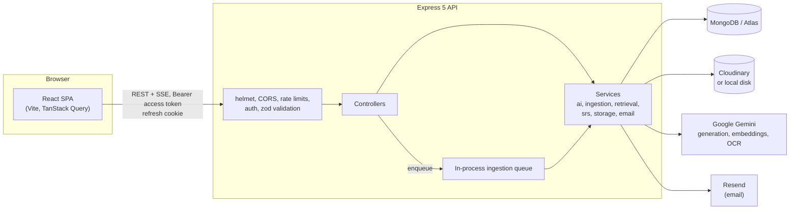
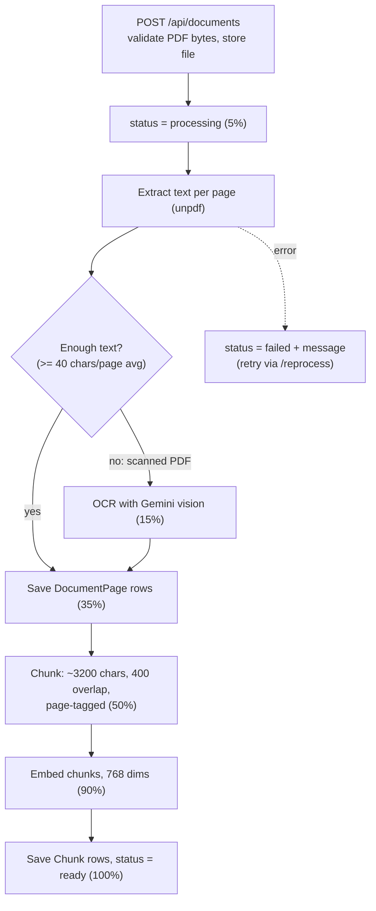
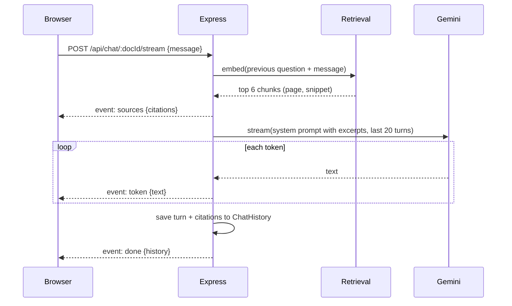

# StudyTantra

**An AI study assistant that turns your PDFs into an interactive, spaced-repetition study system.**

Upload lecture notes, textbooks or handouts. StudyTantra extracts the text (with OCR for scans), indexes it for semantic search, and gives you page-cited AI chat, flashcards, quizzes, summaries, a spaced-repetition review queue, weak-topic tracking and an exam study planner.

Built with the MERN stack (MongoDB, Express 5, React 19, Node 20+) and Google Gemini.

---

## Contents

1. [Why this exists](#1-why-this-exists)
2. [Feature tour](#2-feature-tour)
3. [Architecture](#3-architecture)
4. [Tech stack](#4-tech-stack)
5. [Repository layout](#5-repository-layout)
6. [Getting started](#6-getting-started)
7. [Configuration reference](#7-configuration-reference)
8. [API reference](#8-api-reference)
9. [Data model](#9-data-model)
10. [Subsystems in depth](#10-subsystems-in-depth)
11. [Frontend](#11-frontend)
12. [Security model](#12-security-model)
13. [Limits and quotas](#13-limits-and-quotas)
14. [Testing and CI](#14-testing-and-ci)
15. [Deployment](#15-deployment)
16. [Operations](#16-operations)
17. [Known limitations](#17-known-limitations)
18. [Roadmap](#18-roadmap)
19. [Troubleshooting](#19-troubleshooting)
20. [Contributing](#20-contributing)

---

## 1. Why this exists

Students study from PDFs, but reading them is passive and slow to recall from. Writing flashcards and practice questions by hand is tedious, and it is hard to see which topics are actually weak.

StudyTantra automates the loop that works: read, get questions generated, answer them, review on a schedule, and focus time on what you keep getting wrong.

| Problem | What StudyTantra does |
|---|---|
| Passive reading | Chat with the document; every answer cites the page it came from and jumps the viewer there |
| Manual card and quiz making | Generates flashcards and quizzes from the whole document, a page range, or a single topic |
| Forgetting | FSRS spaced repetition schedules each card right before you would forget it |
| Not knowing what is weak | Per-topic accuracy from quizzes and card reviews; one-click practice on weak topics |
| Exam panic | A day-by-day study plan up to your exam date, weighted toward weak topics |

---

## 2. Feature tour

### Documents

- Upload PDFs (up to 10 MB). Supported formats include standard and octet-stream MIME types with `%PDF-` magic-byte inspection (supporting UTF-8 BOM and scanner headers). Files are private: stored with authenticated delivery and only ever served to their owner.
- Background processing pipeline with live status and progress: per-page text extraction, automatic OCR for scanned PDFs, chunking and embeddings. Failed documents or unreadable scans gracefully report actionable failure states and can be re-processed.
- **Continuous vertical scroll PDF viewer** (default) and single-page viewer with responsive container scaling, zoom presets (Fit Width, Fit Page, 50%–200%), and dynamic `IntersectionObserver` page synchronization.
- **Interactive passage tools**: Select text in the PDF to **Explain**, **Simplify**, **Make a flashcard**, or **Ask in chat**.
- Rename documents, favourite them, search the library, and group documents into **collections** (for example "Semester 5 - DBMS").

### AI study tools

- **Grounded chat**: retrieval-augmented, streamed token by token, with page citations. Cross-document chat works over a whole collection.
- **Summaries**: Markdown study summaries, cached on the document and regenerable.
- **Flashcards**: generate from the whole document, a page range, or a topic, with difficulty control. New cards are deduplicated against the existing deck; optionally replace the deck instead.
- **Quizzes**: four question types, multiple choice, true/false, fill-in-the-blank and short answer. Free-text answers are graded by the AI with feedback. Quizzes can span a whole collection.
- Quiz answer keys never reach the client until you check or submit; grading happens on the server.

### Learning science

- **Spaced repetition** with the FSRS scheduler. Rate each card Again, Hard, Good or Easy; the buttons preview the next interval. A daily new-card limit keeps sessions manageable. Missed cards come back later in the same session. Keyboard: `Space` flips, `1`-`4` rate.
- **Quiz attempt history** with per-question results, so you can review past attempts.
- **Weak topics**: accuracy per topic from quiz answers and flashcard reviews, with practice shortcuts.
- **Streaks, daily goal and a year-long activity heatmap.**
- **Study planner**: enter an exam date and the documents to cover; the AI builds a dated plan (read, review, flashcards, quiz tasks) that prioritises your weak topics. Today's tasks appear on the dashboard.
- **Export**: flashcards to CSV or Anki-importable text; print or save quiz reviews and summaries as PDF.

### Accounts and security

- Email and password, or Google sign-in. Email verification and password reset by email.
- Short-lived access tokens held in memory plus rotating refresh sessions in an httpOnly cookie. "Log out other devices" revokes every other session.
- Change password, change email (confirmed via the new address), delete account (removes every record and stored file).

---

## 3. Architecture



Controllers never call a model SDK directly. Every AI call goes through `backend/src/services/ai/index.js`, which exposes task-level functions (`summarize`, `generateFlashcards`, `chatStream`, `ocrPdf`, ...) over a provider interface. There are two providers: `gemini` and a deterministic offline `mock` used by tests and keyless local development.

### Document ingestion

Runs in the background after upload. The client polls the document's `status` and `progress`.



On every boot the server re-queues documents interrupted mid-processing and any legacy documents that predate the pipeline.

### Grounded chat



Citations are stored with each model message. Clicking one in the UI opens the PDF viewer at that page.

---

## 4. Tech stack

| Layer | Technology |
|---|---|
| Frontend | React 19, Vite 8, Tailwind CSS 4, React Router 7, TanStack Query 5, react-pdf, react-markdown + remark-gfm, lucide-react, axios |
| Backend | Node.js 20+, Express 5, Mongoose 9, zod (validation and env), pino + pino-http (logging), helmet, express-rate-limit, multer |
| AI | Google Gemini via `@google/genai`: structured JSON output, streaming, embeddings, vision OCR |
| Retrieval | 768-dimension embeddings stored on MongoDB chunks; cosine similarity in Node by default, or Atlas Vector Search |
| PDF | `unpdf` for per-page text extraction |
| Scheduling | `ts-fsrs` (Free Spaced Repetition Scheduler) |
| Storage | Cloudinary (authenticated delivery) or local disk |
| Auth | JWT access tokens, opaque rotating refresh tokens, bcryptjs, Google Identity Services via `google-auth-library` |
| Email | Resend (falls back to logging the email body when no key is set) |
| Observability | pino structured logs with redaction, optional Sentry on both ends, `/healthz` |
| Testing | Vitest, Supertest, mongodb-memory-server, Testing Library, Playwright |
| CI/CD | GitHub Actions; Railway (API) and Vercel (web) |

---

## 5. Repository layout

```text
.
├── backend/
│   ├── src/
│   │   ├── app.js                 Express app: CORS, helmet, rate limits, routes, error handling
│   │   ├── server.js              Boot: listen first, then connect MongoDB, then resume ingestion
│   │   ├── instrument.js          Sentry initialisation
│   │   ├── config/                env.js (zod-validated), logger.js, db.js, cloudinary.js
│   │   ├── routes/                auth, documents, ai, flashcards, chat, quizzes, dashboard, learning
│   │   ├── controllers/           One file per domain (auth, document, chat, quiz, review, ...)
│   │   ├── middlewares/           authMiddleware, validate, aiRateLimit, uploadMiddleware, errorMiddleware
│   │   ├── validators/            zod schemas: authSchemas, studySchemas, learningSchemas
│   │   ├── models/                Mongoose models (see Data model)
│   │   ├── services/
│   │   │   ├── ai/                index.js (tasks + prompts), providers/gemini.js, providers/mock.js
│   │   │   ├── ingestion/         ingest.js (pipeline), chunk.js, queue.js (in-process queue)
│   │   │   ├── retrieval.js       Semantic search (app-side or Atlas)
│   │   │   ├── studySource.js     Builds the text an AI task reads (all / page range / topic / collection)
│   │   │   ├── srs.js             FSRS wrapper
│   │   │   ├── activity.js        Activity log, streaks, heatmap, topic stats, weak-topic rule
│   │   │   ├── auth.js            Access tokens, refresh-session rotation, cookies
│   │   │   ├── storage.js         Cloudinary / local file storage
│   │   │   ├── email.js           Verification and reset emails
│   │   │   ├── pdf.js             Per-page text extraction
│   │   │   └── cascade.js         Document and account deletion cascades
│   │   └── utils/                 grading.js, limits.js, tokens.js, ownership.js, httpError.js
│   ├── scripts/
│   │   ├── e2e-server.js          Self-contained API: in-memory MongoDB, mock AI, local storage
│   │   └── gemini-smoke.js        Optional real-Gemini smoke test
│   ├── tests/                     API test suites (Vitest + Supertest)
│   ├── package-lock.json          Backend lockfile (independent)
│   └── .env.example
├── frontend/
│   ├── public/                    study.png, favicon.ico, favicon.png, icons.svg
│   ├── src/
│   │   ├── App.jsx                Routes, route guards, lazy-loaded pages
│   │   ├── main.jsx               Query client, Sentry, error boundary
│   │   ├── api/hooks.js           All server data access as TanStack Query hooks
│   │   ├── lib/                   api.js (client + silent refresh), chatStream.js (SSE), generation.js, ...
│   │   ├── context/               AuthContext, ThemeContext
│   │   ├── components/            Layout, Sidebar, Header, PdfViewer, ChatInterface, QuizEngine, FlashcardViewer, ...
│   │   ├── pages/                 One component per route
│   │   └── index.css              Design tokens, glass-card utilities, keyframes
│   ├── e2e/                       Playwright specs
│   ├── package-lock.json          Frontend lockfile (independent)
│   ├── vercel.json                SPA rewrite
│   └── .env.example
├── icons/
│   └── study.png                  Source branding icon
├── docs/plans/                    Roadmap and earlier revamp plan
├── .github/workflows/ci.yml       Backend, frontend and e2e jobs (runs on Node 22)
├── .npmrc                         legacy-peer-deps=true
└── package.json                   Declares workspaces; `start` runs the backend
```

---

## 6. Getting started

**Requirements:** Node.js 20 or newer, a MongoDB database (local or Atlas), and a [Gemini API key](https://aistudio.google.com/apikey). Cloudinary credentials are optional if you use local file storage.

> **Workspace & Dependency Architecture**:
> The repo root declares npm workspaces, but `backend/` and `frontend/` each maintain their own independent lockfile. The root `package-lock.json` is intentionally excluded from Git to prevent workspace peer collisions.
> In Node 22 / npm 10+, always install using `--workspaces=false --legacy-peer-deps` so optional peer dependencies (such as MongoDB's GCP KMS peers) resolve deterministically.

### Run the full stack

```bash
# 1. Backend
cd backend
cp .env.example .env          # Windows cmd: copy .env.example .env
# Edit .env: MONGO_URI, JWT_SECRET (16+ chars), GEMINI_API_KEY, and Cloudinary keys or STORAGE_DRIVER=local
npm install --workspaces=false --legacy-peer-deps
npm run dev                   # http://localhost:5000  (nodemon)

# 2. Frontend (second terminal)
cd frontend
cp .env.example .env          # VITE_API_URL=http://localhost:5000
npm install --workspaces=false --legacy-peer-deps
npm run dev                   # http://localhost:5173
```

Open <http://localhost:5173>, register, upload a PDF, and wait for the status to reach **Ready** before generating anything.

### Run with no external services

Set these in `backend/.env` to run without a Gemini key or Cloudinary:

```ini
AI_PROVIDER=mock        # deterministic fake AI; refused when NODE_ENV=production
STORAGE_DRIVER=local    # PDFs are written to LOCAL_UPLOAD_DIR (default: uploads/)
```

You still need a MongoDB instance. To skip that too, start the self-contained API, which boots an in-memory MongoDB with mock AI and local storage:

```bash
node backend/scripts/e2e-server.js       # http://localhost:5055
# then run the frontend with VITE_API_URL=http://localhost:5055
```

Mock embeddings are hashed bag-of-words vectors, so retrieval returns sensible chunks without a real model. Mock flashcards and quizzes are placeholder text.

### Useful commands

| Where | Command | Purpose |
|---|---|---|
| `backend` | `npm run dev` | API with auto-reload |
| `backend` | `npm start` | API (production mode entry) |
| `backend` | `npm test` | API tests (in-memory MongoDB, mock AI) |
| `backend` | `npm run smoke:gemini` | A few real Gemini calls using your key |
| `frontend` | `npm run dev` | Vite dev server |
| `frontend` | `npm run build` | Production build into `dist/` |
| `frontend` | `npm run lint` | ESLint |
| `frontend` | `npm test` | Unit and component tests |
| `frontend` | `npm run test:e2e` | Playwright; starts the e2e API and Vite itself |

The server validates its environment at startup and exits with a readable list of problems if anything required is missing or inconsistent.

---

## 7. Configuration reference

### Backend (`backend/.env`)

| Variable | Default | Description |
|---|---|---|
| `NODE_ENV` | `development` | `development`, `test` or `production` |
| `PORT` | `5000` | HTTP port |
| `MONGO_URI` | required | MongoDB connection string |
| `JWT_SECRET` | required | Access-token signing secret, at least 16 characters |
| `CLIENT_URL` | `http://localhost:5173` | Public frontend URL; used to build links in emails |
| `ALLOWED_ORIGIN` | none | Extra CORS origins, comma-separated. Matched exactly |
| `AI_PROVIDER` | `gemini` | `gemini` or `mock` (mock is rejected in production) |
| `GEMINI_API_KEY` | required if `gemini` | Google AI Studio key |
| `GEMINI_MODEL` | `gemini-2.5-flash` | Model for generation, chat, grading, OCR and planning |
| `GEMINI_EMBED_MODEL` | `gemini-embedding-001` | Embedding model (requested at 768 dimensions) |
| `AI_RATE_LIMIT_PER_HOUR` | `60` | Per-user hourly cap on AI actions |
| `VECTOR_SEARCH` | `app` | `app` scores embeddings in Node; `atlas` uses Atlas Vector Search |
| `STORAGE_DRIVER` | `cloudinary` | `cloudinary` or `local` |
| `LOCAL_UPLOAD_DIR` | `uploads` | Directory for the local driver |
| `CLOUDINARY_CLOUD_NAME`, `CLOUDINARY_API_KEY`, `CLOUDINARY_API_SECRET` | required if `cloudinary` | Cloudinary credentials |
| `RESEND_API_KEY` | none | Enables real email. Without it, emails are printed to the log |
| `EMAIL_FROM` | `StudyTantra <onboarding@resend.dev>` | Sender address |
| `GOOGLE_CLIENT_ID` | none | Enables Google sign-in (OAuth client ID) |
| `SENTRY_DSN` | none | Enables backend error reporting |
| `LOG_LEVEL` | by environment | `fatal` to `trace`, or `silent`. Default: `debug` in dev, `info` in prod, `silent` in tests |

### Frontend (`frontend/.env`)

| Variable | Default | Description |
|---|---|---|
| `VITE_API_URL` | `http://localhost:5000` | API base URL, without trailing slash or `/api` |
| `VITE_GOOGLE_CLIENT_ID` | none | Same OAuth client ID as the backend; shows the Google button |
| `VITE_SENTRY_DSN` | none | Enables frontend error reporting |

---

## 8. API reference

All endpoints are under `/api`. Unless marked **public**, they require `Authorization: Bearer <accessToken>`. Request bodies are validated with zod; failures return `400` with `{ message, details }`. Every error uses the shape `{ message, details? }`.

### Health

| Method and path | Description |
|---|---|
| `GET /` | Plain-text liveness |
| `GET /healthz` | `200 {status:"ok"}` when MongoDB is connected, otherwise `503`. Excluded from request logs |

While MongoDB is disconnected, every `/api/*` route returns `503` immediately rather than hanging.

### Auth (`/api/auth`)

| Method and path | Access | Description |
|---|---|---|
| `POST /register` | public | Create an account, send a verification email, start a session |
| `POST /login` | public | Email and password sign-in |
| `POST /google` | public | Sign in or sign up with a Google ID token (`{ credential }`) |
| `POST /forgot-password` | public | Always responds identically so emails cannot be enumerated |
| `POST /reset-password` | public | `{ token, password }`; signs out every device |
| `POST /verify-email` | public | `{ token }`; also confirms a pending email change |
| `POST /refresh` | cookie | Rotate the refresh cookie, return a new access token |
| `POST /logout` | cookie | Revoke this device's session |
| `GET /me` | user | Current user |
| `POST /logout-others` | user | Revoke every other session; returns the count |
| `POST /resend-verification` | user | Rate limited to 5 per hour |
| `PUT /profile` | user | Update name, or request an email change (needs current password) |
| `PUT /preferences` | user | `dailyGoal`, `newCardsPerDay`, `timezone` |
| `PUT /password` | user | Change password; revokes other sessions |
| `DELETE /account` | user | `{ password?, confirm: "DELETE" }`; cascades all data |

Register, login, Google, forgot and reset share a stricter limit of 20 requests per 15 minutes per IP.

### Documents (`/api/documents`)

| Method and path | Description |
|---|---|
| `POST /` | Upload a PDF (`multipart/form-data`, field `document`, optional `title`). Returns `201` with `status: "processing"` |
| `GET /` | List the user's documents |
| `GET /:id` | One document, including `status`, `progress`, `pageCount`, `ocr`, `summary` |
| `PATCH /:id` | Rename, or move into or out of a collection (`collectionId` or `null`) |
| `DELETE /:id` | Delete the file and everything generated from it |
| `GET /:id/file` | Stream the PDF inline (owner only; the only way to read a file) |
| `POST /:id/reprocess` | Re-run ingestion after a failure. `409` if already processing |
| `PUT /:id/favorite` | Toggle favourite |

### AI (`/api/ai`)

| Method and path | Description |
|---|---|
| `POST /summary/:docId` | Generate and cache a Markdown summary |
| `POST /explain/:docId` | `{ text, mode: "explain" or "simplify" }`; explains a selected passage using nearby context |

### Chat (`/api/chat`)

Each route exists for a single document (`/:docId...`) and for a whole collection (`/collection/:collectionId...`).

| Method and path | Description |
|---|---|
| `POST /:docId/stream` | Streamed answer over Server-Sent Events: `sources`, then `token`*, then `done` or `error` |
| `POST /:docId` | Same answer as one JSON response `{ reply, citations, history }` |
| `GET /:docId` | Conversation history |
| `DELETE /:docId` | Clear the conversation |

Messages are limited to 4000 characters.

### Flashcards (`/api/flashcards`)

| Method and path | Description |
|---|---|
| `POST /generate/:docId` | `{ count, scope, difficulty, replace }`; adds deduplicated cards or replaces the deck |
| `POST /from-selection/:docId` | Create a card from selected text |
| `GET /:docId` | A document's cards |
| `GET /export/:docId?format=csv\|anki` | Download the deck |
| `PUT /:id/favorite` | Toggle favourite |
| `DELETE /:id` | Delete a card |

`scope` is one of `{type:"all"}`, `{type:"pages", from, to}` or `{type:"topic", query}`.

### Quizzes (`/api/quizzes`)

| Method and path | Description |
|---|---|
| `POST /generate/:docId` | `{ count, scope, difficulty, types }`; answers are stripped from the response |
| `POST /generate/collection/:collectionId` | Quiz across a collection (topic or whole-collection scope) |
| `GET /document/:docId`, `GET /collection/:collectionId` | Quizzes, answers hidden |
| `GET /:id` | One quiz, answers hidden |
| `POST /:id/check` | `{ index, answer }`; instant feedback with the correct answer and explanation |
| `POST /:id/submit` | `{ answers: [...] }`; graded on the server, stored as an attempt |
| `GET /:id/attempts` | Attempt history; the answer key is included only after at least one attempt |

### Review, insights, collections, plans, dashboard

| Method and path | Description |
|---|---|
| `GET /review/queue?document=&limit=` | Due cards first, then new cards up to the daily allowance; includes interval previews |
| `POST /review/:id` | `{ rating: 1-4 }`; reschedules the card and logs activity |
| `GET /insights/overview` | Streak, daily goal, due counts, 365-day heatmap, weak topics, recent activity, today's plan |
| `GET /insights/topics?document=` | Accuracy per topic, weakest first |
| `GET/POST /collections`, `GET/PUT/DELETE /collections/:id` | Collection CRUD |
| `GET/POST /plans`, `GET/DELETE /plans/:id` | Study plans |
| `PATCH /plans/:id/tasks/:taskId` | `{ done }`; mark a task complete |
| `GET /dashboard` | Totals and quiz statistics for the stat cards |

---

## 9. Data model

| Model | Purpose | Notable fields and indexes |
|---|---|---|
| `User` | Account | `email` (unique), optional `password`, `googleId` (sparse unique), `emailVerified`, `pendingEmail`, hashed verification and reset tokens, `preferences` (`dailyGoal`, `newCardsPerDay`, `timezone`), `tokenVersion` |
| `Session` | One refresh-token session per device | `tokenHash` (unique), `previousTokenHash`, `rotatedAt`, `revokedAt`, `expiresAt` with a TTL index so expired sessions are removed automatically |
| `Document` | An uploaded PDF | `status` (`processing`, `ready`, `failed`), `progress`, `ocr`, `pageCount`, `chunkCount`, `summary`, `collectionId`, private storage fields (stripped from JSON). Index `{user, createdAt}` |
| `DocumentPage` | Extracted text of one page | Unique `{document, page}` |
| `Chunk` | Retrievable slice with embedding | `page`, `pageEnd`, `text`, `embedding[768]`. Index `{document, index}` |
| `Flashcard` | A card | `topic`, `question`, `answer`, FSRS state in `srs` (absent means new), `lastReviewed`. Index `{user, srs.due}` |
| `Quiz` | A generated quiz | Questions with `type`, `options`, `correctAnswer`, `explanation`, `topic`; `scope`, `difficulty`, `attemptsCount`, `bestScore`. `toPublicJSON()` strips answers |
| `QuizAttempt` | One submission | Per-answer `correct`, `topic`, `feedback`; `score`, `total`, `percentage` |
| `ChatHistory` | A conversation | Messages with `citations`; belongs to a document or a collection |
| `Collection` | A group of documents | Unique `{user, name}` |
| `Activity` | Append-only study log | `type` (`upload`, `review`, `quiz`, `chat`, `generate`), `meta`. Powers streaks, the heatmap and the activity feed |
| `StudyPlan` | An exam plan | `examDate`, `minutesPerDay`, `days[{date, tasks[]}]` with dates in the user's timezone |

**Cascades.** `services/cascade.js` is the single place that knows what hangs off a document (cards, quizzes, attempts, chats, chunks, pages, plan references, stored file) and off a user. Keep it in sync when adding per-document collections.

---

## 10. Subsystems in depth

### Authentication and sessions

- **Access token**: a 15-minute JWT carrying the user id, session id (`sid`) and token version (`tv`). The browser keeps it in memory only, never in `localStorage`.
- **Refresh token**: 32 random bytes, stored only as a SHA-256 hash. It lives in an httpOnly cookie named `st_rt`, scoped to the path `/api/auth`, valid 30 days. In production the cookie is `Secure` and `SameSite=None`; in development `SameSite=Lax`.
- **Rotation**: every refresh issues a new token. A 30-second grace window tolerates two tabs refreshing at once. Presenting an already-rotated token outside that window means it was copied, so the session is revoked.
- **Revocation**: access tokens die with their session and with any password change (the `tokenVersion` bump). Logout, "log out other devices", password change and reset all revoke sessions.
- **Silent refresh on the client**: a 401 triggers one shared refresh call, then the original request is retried. Credential endpoints are excluded so a wrong password shows an error instead of looping.
- **Google sign-in**: the ID token is verified server-side and its email must be verified. Linking to an existing account happens only if that account's email is verified. If someone registered an email without ever verifying it, that account is released and the real owner gets a fresh one, which defeats pre-registration account hijacking.
- **Email change**: requires the current password; the new address becomes active only after its link is opened.
- **Delete account**: password accounts confirm with the password; Google-only accounts must have signed in within the last 15 minutes. Both must type `DELETE`.

### Ingestion

`services/ingestion/ingest.js` is idempotent: re-running it replaces the document's pages and chunks. Text is extracted per page with `unpdf`. 
- **Magic-byte validation**: The upload middleware and controller verify the PDF header `%PDF-` across the first 1024 bytes to accommodate UTF-8 byte-order marks (BOM) or scanner exporter preambles.
- **OCR fallback**: If the PDF averages fewer than 40 characters per page, it is treated as scanned and transcribed page by page with Gemini vision (`ocr: true`).
- **Zero-character guard**: If text extraction and OCR fallback both extract zero characters, the document status transitions to `failed` with a clear explanation instead of leaving an empty 0-chunk document.
- **Chunking & Embeddings**: Pages are split into overlapping sentence-aligned chunks of about 3200 characters (roughly 800 tokens) with 400 characters of overlap, each tagged with its page range, then embedded in batches of 50.

The queue is a small in-process worker pool (concurrency 2). It suits a single API instance; see [Known limitations](#17-known-limitations).

### Retrieval

A query is embedded with the query task type, then chunks are ranked by cosine similarity. In `app` mode scoring happens in Node, which is fine for per-user libraries (a 300-page book is a few hundred chunks). In `atlas` mode it uses `$vectorSearch` on the index `chunk_embeddings`. For chat, the previous user question is prepended to the query so follow-ups like "what about the second one?" retrieve well.

### Building study material

`services/studySource.js` decides what the model reads:

| Scope | Source |
|---|---|
| Whole document | All page text in order, page-tagged |
| Page range | Only the selected pages |
| Topic | The 12 most relevant chunks (16 for collections), restored to document order |
| Collection | An equal share of a 350,000-character budget per document, or topic retrieval across all of them |

Text sent to the model is capped at about 100k tokens. Generation and chat refuse documents that are still processing (`409`) or failed.

### Generation and grading

- Flashcards and quizzes use Gemini structured output (a JSON schema), not free-text parsing.
- Quiz output is sanitised: multiple-choice questions need at least two options including the correct one, true/false is normalised, and malformed questions are dropped.
- Flashcard generation passes existing questions to the model as "do not repeat" and also dedupes by normalised question text.
- Grading is local for objective questions. Fill-in and short-answer responses that are not exact matches are graded in one batched AI call that accepts answers correct in meaning, and returns feedback.

### Spaced repetition

Cards use FSRS (`ts-fsrs`) with 90% target retention and fuzzing so due dates do not bunch up. A card with no `srs` state is new. The queue returns due reviews oldest first, then new cards up to `newCardsPerDay` minus the number of new cards already started today, evaluated in the user's timezone. Each review is written to `Activity`, which feeds streaks and topic statistics.

### Insights

- **Streak**: consecutive local days with at least one review or quiz. Today not yet studied does not break the current streak until the day ends.
- **Daily goal**: reviews completed today against `dailyGoal`.
- **Weak topic**: a topic with at least 3 attempts in the last 90 days and under 60% accuracy. A quiz answer counts as correct if it was right; a flashcard review counts as a miss only when rated Again.

### Study planner

The planner sends the AI your documents (title, known topics, short summary), the dates until the exam (capped at 45 days; plans longer than that cover the next 45 and tell you to create another later), your daily minute budget and your weak topics. The response is schema-constrained and then sanitised: unknown task types fall back to `review`, task titles and descriptions are length-capped, document ids must belong to the plan, and each day holds at most 6 tasks. Tasks link into the relevant page of the app.

### File storage

With Cloudinary, PDFs are uploaded as `raw` assets with `type: authenticated` and read back through signed URLs server-side. With the local driver they are written to disk. In both cases the browser never receives a storage URL: it requests `GET /api/documents/:id/file`, which checks ownership. Documents uploaded before private storage existed still resolve through their legacy URL. Uploads are checked by their `%PDF-` magic bytes, not just the declared MIME type. The frontend passes raw binary blobs directly to the PDF viewer to avoid object URL revocation race conditions in React 19.

---

## 11. Frontend

### Routes

| Path | Page | Notes |
|---|---|---|
| `/login`, `/register`, `/forgot-password` | Auth pages | Guest-only; redirect to the dashboard when signed in |
| `/reset-password`, `/verify-email` | Token landing pages | Public |
| `/dashboard` | Dashboard | Streak, daily goal, due cards, today's plan, weak topics, heatmap, stats, recent activity |
| `/documents` | Library | Search (also from the header), collection chips, upload modal, favourites |
| `/documents/:id` | Document | PDF viewer beside Chat / Summary tabs; selection actions; citation jumping |
| `/collections/:id` | Collection | Cross-document chat and quizzes |
| `/review` | Spaced repetition | Keyboard-driven review session |
| `/flashcards` | Flashcards | Generate with scope and difficulty, practice, list view, export |
| `/quizzes` | Quizzes | Generate with scope, difficulty and question types, take and review |
| `/planner`, `/planner/:id` | Study planner | Create plans, tick off tasks |
| `/favorites` | Favourites | Starred documents |
| `/profile`, `/settings` | Account | Profile and email verification, delete account; study goals, password, sessions |

Pages are lazy-loaded; the PDF viewer pulls in pdf.js, so the document page is the heaviest chunk.

### Data fetching and state

- **TanStack Query** owns all server state. Every endpoint is wrapped in a hook in `src/api/hooks.js`, with a 30-second stale time and a single retry that skips client errors.
- **`lib/api.js`** is the one axios instance. It attaches the in-memory access token, performs the shared silent refresh, and exposes `authFetch` for streaming.
- **`lib/chatStream.js`** parses the SSE stream (`sources`, `token`, `done`, `error`) from a `fetch` response, since axios cannot stream in the browser. It supports abort.
- **Contexts**: `AuthContext` (user, login, logout, profile and preference updates) and `ThemeContext` (stores a `light`, `dark` or `system` preference).

### Design system

The interface is dark-first: a deep navy base (`#0b1120`) with an amber accent. `src/index.css` defines the design tokens and the shared utilities used across pages:

| Utility | Effect |
|---|---|
| `glass-card`, `glass-card-hover` | Translucent blurred surface with a hairline border; hover adds an amber border glow and lift |
| `gradient-border` | Subtle amber gradient outline via CSS masking |
| `stagger-children` | Children animate in with a short stagger |
| `btn-press`, `link-underline` | Press feedback on buttons, animated underline on links |
| `animate-fade-in`, `animate-slide-up`, `animate-scale-in`, ... | Keyframe animations registered as Tailwind theme animations |

Charts and the heatmap are hand-rolled SVG/CSS components (`ActivityHeatmap`, `GoalMeter`) with no charting dependency.

### In-app PDF Viewer (`PdfViewer.jsx`)

The document reader is built on `react-pdf` and customized for deep study workflows:
- **Continuous Top-to-Down Vertical Scroll (Default)**: Renders all pages sequentially in a continuous scroll container, allowing natural reading from top to bottom.
- **Dynamic Scroll Synchronization**: Uses an `IntersectionObserver` to track the visible page in the viewport, syncing the page counter (`X / Y`) and page input automatically without cascading re-renders.
- **Programmatic Citation Jumping**: Clicking any page citation in Chat or summaries smoothly scrolls directly to that page element.
- **View Mode Toggle**: Users can toggle between Continuous Scroll mode and single-page view.
- **Responsive Layout & Zoom**: Monitors container dimensions with `ResizeObserver` to resize canvas width dynamically, with preset zoom options (*Fit Width*, *Fit Page*, 50%–200%).
- **Interactive Passage Toolbar**: Text selection triggers a floating action bar allowing one-click **Explain**, **Simplify**, **Create Flashcard**, or **Send to Chat**.

---

## 12. Security model

| Area | Measure |
|---|---|
| Transport and headers | `helmet`; `trust proxy` set for platforms behind a reverse proxy |
| CORS | Exact-match allow-list of normalised origins (a prefix match would admit `app.vercel.app.evil.com`); credentials enabled |
| Authentication | Short-lived JWTs in memory; opaque hashed refresh tokens in httpOnly cookies; rotation with replay detection; `tokenVersion` invalidation |
| Passwords | bcrypt; 8 to 128 characters; credential endpoints rate limited |
| Account takeover | Email changes need the current password and verification; Google linking requires verified emails and releases unverified claims; password reset always answers the same |
| Authorisation | Every resource lookup goes through an ownership check scoped to the signed-in user |
| Input | zod validation on bodies, params and queries; ObjectId checks; 1 MB JSON limit; 10 MB PDF limit with magic-byte verification |
| Quiz integrity | Answer keys are stripped until a question is checked or the quiz is attempted; grading is server-side |
| File privacy | Authenticated Cloudinary delivery or local disk; files only reachable through the ownership-checked endpoint; storage fields stripped from API responses |
| Abuse and cost | Per-IP global limit (300 per 15 minutes), per-user hourly AI limit, higher grading limit, per-user email limit, per-account email cooldown, hard caps on generated item counts |
| Error handling | Uniform error shape; 5xx messages are never leaked to clients; `uncaughtException` logs and exits so the platform restarts a clean process |
| Logging | pino with `authorization`, `cookie`, `set-cookie`, `password` and `token` fields redacted |

---

## 13. Limits and quotas

| Limit | Value |
|---|---|
| Upload size / type | 10 MB, PDF only (one file per request) |
| JSON body | 1 MB |
| Flashcards per generation | 1 to 30 (default 10) |
| Quiz questions per generation | 1 to 20 (default 5) |
| Chat message | 4000 characters |
| Selected-text actions | 3 to 2000 characters |
| Review queue size | up to 200 per request (default 50) |
| Daily goal / new cards per day | 1 to 500 / 0 to 200 |
| AI actions per user | `AI_RATE_LIMIT_PER_HOUR` per hour (default 60); covers chat, generation, summaries, explain, uploads, reprocessing and plan creation |
| Quiz checking and submission | 5x the AI limit per hour (default 300) |
| Verification / email-change emails | 5 per user per hour, 1 per minute per account |
| Credential endpoints | 20 per 15 minutes per IP |
| All API requests | 300 per 15 minutes per IP |
| Study plan | up to 20 documents, 15 to 600 minutes per day, 45-day horizon, 6 tasks per day |
| Chat context | last 20 turns plus 6 retrieved excerpts |
| Token lifetimes | access 15 minutes, refresh 30 days, email verification 24 hours, password reset 1 hour |

---

## 14. Testing and CI

| Suite | Tooling | Coverage |
|---|---|---|
| Backend API | Vitest, Supertest, mongodb-memory-server, mock AI | `app` (health, CORS), `auth` (sessions, Google, reset, email change, deletion), `documents` (upload, ingestion, privacy), `quizzes` (hidden answers, grading, attempts), `learning` (review, insights, collections, plans), `ai-features` (chat, generation, scopes), `security` |
| Frontend | Vitest, Testing Library, jsdom | API client refresh logic, SSE parser, generation helpers, time formatting, Markdown, QuizEngine, VerifyEmailBanner, charts, Review page |
| End to end | Playwright (Chromium) against `scripts/e2e-server.js` | Register, upload, flashcards, quiz; wrong password shows an error without a reload; spaced repetition, streak, planner and collections |

```bash
cd backend  && npm test
cd frontend && npm run lint && npm test && npm run build
cd frontend && npm run test:e2e        # first run: npx playwright install chromium
cd backend  && npm run smoke:gemini    # optional, uses your real key
```

**CI** (`.github/workflows/ci.yml`) runs on every pull request and on pushes to `main`, on Node 22:

1. **backend**: runs `npm ci --workspaces=false --legacy-peer-deps` and `npm test` (73 tests across 7 test suites, using in-memory MongoDB). `vite` is explicitly pinned in `backend/package.json`'s `devDependencies` so Vitest resolves in isolated peer-dep environments.
2. **frontend**: runs `npm ci --workspaces=false --legacy-peer-deps`, `npm run lint`, `npm test` (20 tests across 9 test suites), and `npm run build`. `@testing-library/dom` is explicitly declared in `frontend/package.json`'s `devDependencies` for Jest-DOM compatibility.
3. **e2e**: after the two above pass, installs Chromium and runs Playwright; uploads traces as an artifact on failure.

The Gemini smoke test is intentionally excluded from CI.

---

## 15. Deployment

The reference setup is **Railway** for the API and **Vercel** for the web app, with **MongoDB Atlas** and **Cloudinary**.

### Backend (Railway)

1. Set `NODE_ENV=production` and every variable from `backend/.env.example` that applies (see [Configuration](#7-configuration-reference)). `CLIENT_URL` must be the public frontend URL, and `ALLOWED_ORIGIN` must include it.
2. Start command: `npm start` (the root `package.json` delegates to the backend workspace).
3. Health check path: `/healthz`. The server begins listening immediately and reports `503` until MongoDB connects, so the platform never marks a database-less instance healthy.
4. Set `RESEND_API_KEY` and `EMAIL_FROM` with a verified domain, or verification and reset emails will only be logged.
5. Documents uploaded before the ingestion pipeline existed are processed automatically on the next boot.

### Frontend (Vercel)

Set `VITE_API_URL` (and optionally `VITE_GOOGLE_CLIENT_ID` and `VITE_SENTRY_DSN`). `vercel.json` rewrites all paths to the SPA entry.

### Serve the API from the same site as the frontend

Sessions rely on an httpOnly refresh cookie. If the frontend is on `*.vercel.app` and the API on `*.railway.app`, that cookie is third-party. Safari already blocks it and Chrome is phasing it out, which signs users out on every reload. Fix it one of two ways:

- Put both behind your own domain, for example `app.example.com` and `api.example.com`.
- Proxy the API through Vercel by adding a rewrite to `frontend/vercel.json`, placed before the SPA rewrite, and set `VITE_API_URL` to the Vercel site's own origin:

  ```json
  { "source": "/api/(.*)", "destination": "https://<your-railway-app>/api/$1" }
  ```

### Scaling retrieval

Chunks are scored in Node by default. For large libraries, create an Atlas Vector Search index named `chunk_embeddings` on `chunks.embedding` (768 dimensions, cosine similarity, with `document` as a filter field) and set `VECTOR_SEARCH=atlas`.

---

## 16. Operations

- **Logs**: structured JSON in production (pretty-printed in development). Set `LOG_LEVEL` to change verbosity. Sensitive fields are redacted.
- **Errors**: set `SENTRY_DSN` / `VITE_SENTRY_DSN` to capture backend and frontend errors.
- **Health**: poll `/healthz`.
- **Stuck documents**: a document in `failed` can be retried from the UI (or `POST /api/documents/:id/reprocess`). Anything left in `processing` after a crash is re-queued on the next boot.
- **Gemini failures**: provider calls retry with backoff; persistent failures return `502` with a friendly message and never expose SDK errors.
- **Cost control**: the per-user hourly AI limit, generation count caps and the per-request context cap bound spend per user.

---

## 17. Known limitations

- **Ingestion queue is in-process.** With more than one API instance, jobs are not shared. Move to a shared queue (BullMQ with Redis, or Agenda on MongoDB) before scaling horizontally.
- **Single AI provider.** The provider interface exists, but only Gemini (and the offline mock) are implemented.
- **PDF only**, 10 MB maximum. No DOCX, PPTX or web pages yet.
- **No billing or plans.** Limits are rate limits, not metered quotas, and every user is effectively on the free tier.
- **Theme.** The UI is designed for the dark palette. The light, dark and system preference in Settings is stored but pages are not yet fully styled for a light theme.
- **Email requires Resend.** Without a key, links appear only in the server log.
- **Planner horizon** is capped at 45 days per plan.
- **Not an installable app.** There is no PWA or offline mode yet.

---

## 18. Roadmap

Phases 0 to 3 of [`docs/plans/level-up-and-productization-plan.md`](docs/plans/level-up-and-productization-plan.md) are implemented: bug and security fixes, the engineering foundation (validation, auth hardening, tests, CI), the RAG pipeline with a PDF viewer and streaming chat, and the learning-science features.

**Phase 4, productisation** is next:

- Freemium plans with metered usage and billing (Razorpay or Stripe), and an admin view of usage and cost
- Public landing page, onboarding with a sample document, and better empty states
- PWA with offline flashcard review
- Email and push reminders for due cards and streaks
- Shareable decks and quizzes, group spaces and a teacher mode
- Privacy policy, terms, consent and data-export flows
- Product analytics and an in-app "report a bad answer" loop

`docs/plans/revamp-plan.md` is the earlier security-focused plan and is kept for history.

---

## 19. Troubleshooting

| Symptom | Likely cause and fix |
|---|---|
| Server exits at startup with "Invalid environment configuration" | A required variable is missing or inconsistent. The message lists each one. Common: `JWT_SECRET` under 16 characters, `GEMINI_API_KEY` missing while `AI_PROVIDER=gemini`, Cloudinary keys missing while `STORAGE_DRIVER=cloudinary` |
| Every API call returns 503 | MongoDB is not connected. Check `MONGO_URI` and `/healthz` |
| Browser shows a CORS error | The frontend origin is not in `ALLOWED_ORIGIN`. It must match exactly, including scheme and port |
| Signed out on every page reload in production | The refresh cookie is third-party. Serve the API from the same site or proxy it through Vercel (see [Deployment](#15-deployment)) |
| Document stays on "Processing" | Check the server log. Large or scanned PDFs take longer. If it is `failed`, use Retry |
| "This document is still being processed" | Chat and generation wait for `status: ready` |
| No verification or reset email arrives | `RESEND_API_KEY` is unset, so the link was written to the server log. Set the key and a verified `EMAIL_FROM` |
| `npm install` behaves oddly at the repo root | Each package has its own lockfile. Install inside `backend/` and `frontend/` with `--workspaces=false --legacy-peer-deps`. Do not commit a root `package-lock.json` |
| `npm ci` fails with `Missing: gcp-metadata from lock file` | npm 10 peer dependency conflict with MongoDB and Google Cloud SDKs. Use `--legacy-peer-deps` on `npm ci` and ensure no accidental root `package-lock.json` is committed |
| Vitest fails with `Cannot find package 'vite'` or `'@testing-library/dom'` | Peer dependencies skipped during legacy install. Ensure `"vite"` is in `backend/package.json` devDependencies and `"@testing-library/dom"` is in `frontend/package.json` devDependencies |
| Vite dev server fails with `Cannot find module .../dist.js` | Concurrently running `npm install` while `vite` was executing on Windows locked native binaries. Stop Vite and run `npm install --workspaces=false --legacy-peer-deps` in `frontend` |
| Google button missing | Set both `GOOGLE_CLIENT_ID` (backend) and `VITE_GOOGLE_CLIENT_ID` (frontend) to the same OAuth client ID |
| Hourly AI limit reached | Raise `AI_RATE_LIMIT_PER_HOUR`, or wait for the window to reset |

---

## 20. Contributing

1. Branch from `main` (for example `feature/<name>`); do not commit to `main` directly.
2. Keep changes covered by tests. Run `npm test` in `backend/` and `npm run lint && npm test && npm run build` in `frontend/` before opening a pull request. CI runs the same checks plus Playwright.
3. New server data access goes through a validated route (zod schema in `validators/`), an ownership-checked lookup, and, if it hangs off a document or user, an entry in `services/cascade.js`.
4. New AI behaviour goes in `services/ai/index.js` behind a task function with a JSON schema, with a matching fixture in the mock provider so tests stay offline.
5. Never commit `.env` files or API keys.

No `LICENSE` file is included yet; add one before accepting outside contributions.
